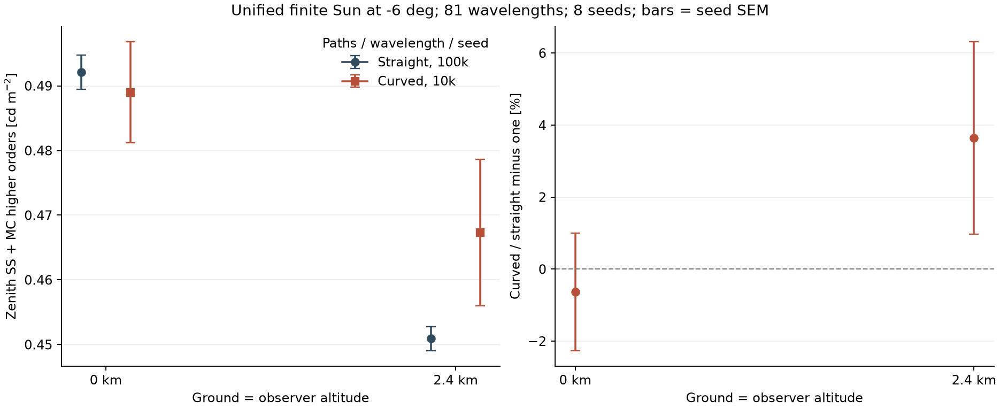

# 连续折射漫射传播：闭合、受控比较与停止边界

2026-11-01。承接[统一太阳源](UNIFIED_SOLAR_SOURCE_AUDIT.md)，完成本轮自由探索。

**现在已有一条在明确范围内自洽的实验链：太阳方向、连续柱量、二维日面与能流一致，
同一个源同时用于确定性一次项和 MC；漫射自由飞行也能在连续折射率中传播。**
独立轨迹、斜视一次积分、能流、太阳盘和步长检验均有持久证据。
完整高阶实验仍受稀有路径方差限制；现有观测没有识别剩余差异的物理原因。
这构成了本轮可签发的结论，不等于生产模型或真实站点问题已经全部解决。

## 1. 先排除一个会制造假信号的传播实现

最初尝试薄球壳常折射率、界面 Snell 折射。界面跳变会产生连续单调 `n(r)r` 中不存在的
全反射和人工波导；掠射误差随层厚缩小也未稳定单调收敛。已保存具体腔体和切线反例，
**否决其作为连续大气的物理参照**。`tools/curved_mc_transport.py` 仅保留复现负结果。

采用的实验后端为 `tools/continuous_curved_mc.py`：

```
dx/ds = d
dd/ds = grad(log n) − d (d · grad(log n))
```

按真实弧长抽样指数自由程，以连续 RK4 推进；子步没有 RNG 或碰撞调用。
全局 majorant 是原 MC fine-grid 消光节点最大值乘1.005，控制其正的 log-linear
插值场。太阳源、NEE 和散射抽样使用碰撞处的 arrival direction；无损传播携带 `L/n²`，
不在每段额外乘折射率因子。源项已包含从局地到探测器的 n² 转换。

地面/顶部使用 Hermite 首交点；子步端点均在地面外时，也检查中间径向最小值，避免
穿地后再次出地而漏撞。常 n 或关闭 bending 的解析分支，与相同 global majorant
的原 MC 六个输出字段逐位一致。这里只对照传播近似，未关闭太阳源折射来改善拟合。

## 2. 独立链与实际数值精度

- Cartesian Hamiltonian 参考独立积分 `p=n*d`、`dx/ds=p/n`、`dp/ds=grad n`，使用
  DOP853 和独立球面 events，未复用 RK4/Hermite 首撞算法。两地面共32条测试在2/1km
  步长下无事件分类分歧；最大位置差2.25cm/2.27mm，方向向量差1.98e−7/2.38e−9。
- 另一条 DOP853 链积分视线、累计消光与一次源，在550nm、太阳−6°、视天顶角
  0/70/85°检查一次项。2→1km 确定性积分差≤17.2ppm；独立重建太阳局地方向、相函数
  符号和 n² 因子，与 source kernel 差≤2.9e−14。
- 70°最初16个小样本种子偏低11.46%（−3.19个经验SE），未删除。额外独立8×50000
  路径得到 MC4.82872e−5，对照确定性4.85298e−5，差−0.50%（−0.26SE）。全部48万
  路径合并差−2.33%，约−1.12个路径报告SE。小样本经验SE不能保证尾部已采够。
- 完整81λ、海平面 seed310、每λ10000路径，2→1km 的 SS+MS 只变化7.8e−9 cd/m²，
  MC一次项逐位不变。斜视另有一个种子在85°发生2.62%的路径耦合变化，16种子聚合
  变化0.158%，小于统计误差。固定种子不保证改变数值步长后逐路径相同。

独立一次积分有意采用与 MC 相同的离散光学场，以隔离传播；代表高度上该场相对连续
密度消光的差约3e−4，不能将此采样差解释为全域 radiance 误差界。
太阳源表也有独立 heldout 误差，详见前阶段报告。

## 3. 完整源、完整光谱的高阶比较

固定 clear/AOD550=.05、300DU、反照率.1、真实太阳盘心−6°、天顶；380–780nm/5nm。
ground=observer=0 或2.4km，同一大气截断。主比较均用2×8日面节点和相同源表 SHA。
每组8个独立种子310–317；曲线每λ每seed10000路径，直线控制100000路径，预算不同。
两者均使用 global majorant；更换 majorant 所改变的随机轨迹不算曲率效应。

| 传播 | 海平面 SS+MS cd/m² | 2.4km SS+MS cd/m² | 高/海 |
|---|---:|---:|---:|
| Global straight | .492102±.002617 | .450925±.001859 | .916324±.006482 |
| Continuous curved，2km步长 | .489009±.007777 | .467331±.011337 | .955669±.035776 |

±均为种子均值的经验标准误，**不包含模型偏差或未知稀有路径尾质量**。
比值取均值之比；同seed协方差用 delta propagation 保留，但不同传播不具有相同路径。
曲线 MC 一次项与确定性一次项的差为海平面+0.83SE、高站−0.70SE。

曲线/直线总量比为海平面 **.9937±.0163**、高站 **1.0364±.0267**。
按8个批次计算的条件Student95%差值区间分别为
`[−.02213,+.01594]`、`[−.01199,+.04480] cd/m²`，均含零。
**本预算未确定曲率修正的符号，更未证明其解释了20–30%的观测残差。**
不能把点估计的几百分点说成已收敛的普适修正；高度比的区间也没有锁定升降方向。



原200–207种子的 coarse-majorant 高站结果.459769±.003474，与新global控制相差约
2.25 combined-SE，故追加新种子310–317的 native100k 控制，而非直接宣称都是噪声。
新native为.454110±.002181；与相同新种子global的差为.003185±.003656，即0.87SE。
原先跨种子差没有转化为已证实的 majorant 系统偏差；完整光学场和 majorant 机制另作
白盒核查。全部旧/新批次均保留，不挑选更贴近观测的一组。

## 4. 太阳盘在 MC 顶点上的收敛

除前阶段的确定性 SS 检验，还在实际 MC 顶点比较16→64个日面节点，保持路径不变。
global-straight两高度各8×10000/λ，指纹、NEE调用数、传播事件和表 SHA 均相同：
高阶相对变化为海平面 `.0058%±.0060%`、高站 `.0045%±.0082%`。
曲线两高度各对 seed310 做同路径复验，SS+MS分别变 `.0063%`/`.0076%`。
曲线各只有一个种子，不报告SE。这些仅约束已访问顶点的聚合敏感性，不是所有未采到
的稀有顶点的误差上界。

## 5. 过程中真实发现的问题与未解决事项

**源表绑定缺口已修复。** 同波长网格不能证明同介质；将海平面表传给高站源，可让
应遮挡的方向误亮。实际 driver 加载已核label和介质签名，既有数据没有错配。
构造入口现在也检查原construction绑定及既有定义签名；两个新回归阻止错配和建表后
medium漂移。前置检查不改任何数值；旧/新源码hash及精确差异补丁保留。

**一次 native139退出原因未知。** 高站长批在seed312落盘后无Python traceback退出，
无对应crash报告/core；没有证据将其归因于某个数组或BLAS。保留前三seed并用
faulthandler续跑313–317，全部成功且无重复seed。成功续跑不是原故障已解释。
这也是实验后端尚不能被当作生产可靠性已验证的原因之一。

**继承边界。** 原MC总散射与各组分分别log插值的微小不一致、相函数抽样离散、50阶
上限与RR尾部仍在；低阶矩探针差约1e−5量级，不构成高阶误差上界。还未覆盖偏振、
任意气溶胶/云、非单像折射率、真实地形或所有太阳高度，不能外推本场景的误差条。

最终源码/fixture冻结后的全量回归：**316 passed，328.79s**。生产气溶胶修复后的六项
物理校验仍为**3PASS/3FAIL**；本实验传播后端未替换生产求解器，不能据此改写物理
通过率。[气溶胶修复](AEROSOL_GRID_AUDIT.md)单独保存其旧/新护栏与独立归因。

## 6. 为什么在这里收敛

本轮已定位并修复可确证的程序语义错误，建立了方向/能流/柱量/传播相容的实验参照，
并把近切线假信号、稀有路径波动和观测定义分开。当前−6°海平面实验仍约为 Koomen
低站photopic数值的.76；跨站的真实大气、季节、仪器和太阳角度契约没有匹配。
[通带与原文审计](TWILIGHT_REFERENCE_AUDIT.md)已说明，已测滤镜修正很小，夜底在−6°
亦很小，但它们没有识别其他残差，更不能用拟合反推太阳轴或校准误差。

继续盲目增加物理项或调整AOD去追跨文献比值，无法从现有数据裁定对错。
更有信息价值的下一步是：将已验证源定义整理为生产唯一实现；为高阶MC降低稀有路径
方差、取得可靠区间；再以匹配通带/时间/站点大气的独立观测检验绝对量。
冷Mie启动性能是另一个根因，应在这些定义清楚后独立推进。

## 复跑

永久证据、日志、数值反例和来源见
[`validation/data/curved_transport_audit/`](../validation/data/curved_transport_audit/README.md)。
统计/图不依赖scratchpad，不重跑MC：

```bash
uv run python -m tools.summarize_curved_transport \
  --directory validation/data/curved_transport_audit/raw \
  --straight-file global-straight-high-stat.jsonl \
  --out validation/data/curved_transport_audit/summary.json \
  --figure validation/data/curved_transport_audit/summary.png
```

脚本核冻结输入SHA，比对记录中的源表SHA/实现hash、盘面/太阳/光谱参数与种子覆盖，
并从原谱重积分。物理源表内容由前阶段独立加载/签名和输入SHA链校验。
长批MC入口为 `tools.run_unified_solar_audit --transport continuous --flight-step 2000`，
显式源表manifest沿用前阶段档案；使用新输出JSONL，勿追加到冻结原数据。
