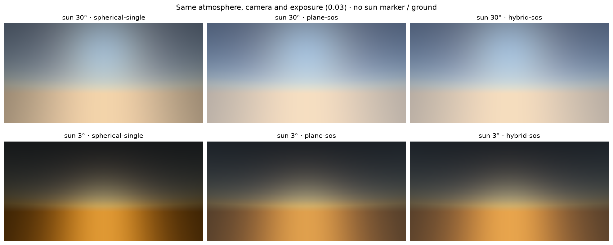
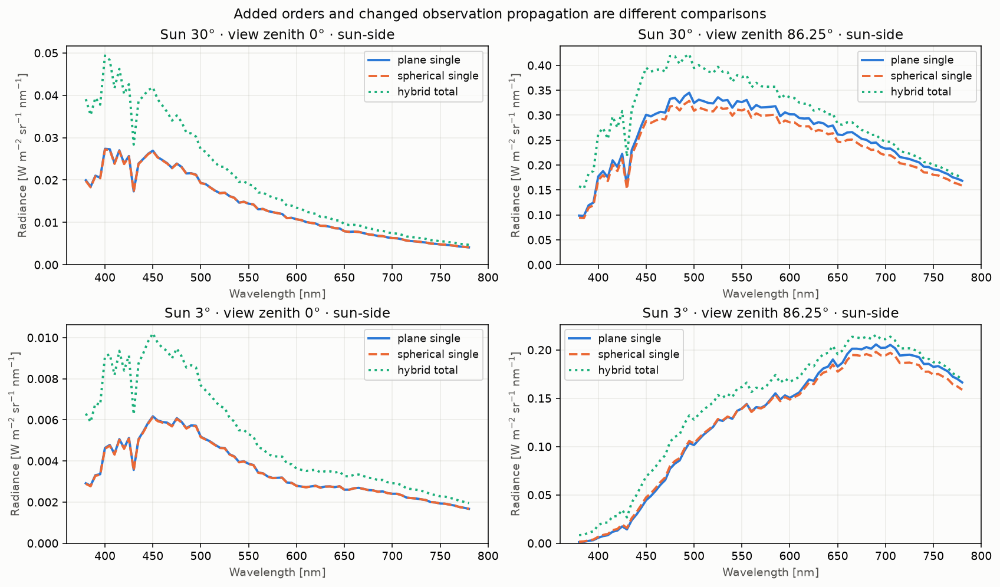

# 近似图：同一目标，不是一条精度排行榜

读者级的主线叙事见[主线文档](MAINLINE.zh.md)：本文是近似契约的定义单源，主线只使用不复制。

给定分层介质、太阳源和观察方向，我们要算的是同一个物理量：天空的光谱辐亮度
**W m⁻² sr⁻¹ nm⁻¹**。不同支路用不同传播近似、散射阶次和数值算法去逼近它；
多算一项不等于已证明更接近观测。当前质量边界只在[STATUS](../STATUS.md)维护。

## 先分开七个维度

1. **介质**：US1976空气、O₃/NO₂、Mie气溶胶及廓线，另有有限的水平场/均匀云扩展。
2. **太阳源**：所有生产后端共享[有限日面源](SOLAR_SOURCE.md)，含折射、连续柱量、
   遮挡与角域增益。太阳输入是折射前坐标；这不意味着漫射光线也弯曲。
3. **观察/漫射几何**：球壳直视线、平面平行传播，或球面直线MC飞行。
4. **折射**：生产默认只在太阳侧；全阶曲线漫射仍是[退休研究](../../experiments/retired/README.md)。
5. **阶次**：一次与高阶/地面返回项；“multiple”是生产总量减一次项的分量定义，
   含相应求解器处理的地面返回，不是单独精确识别的“恰好两次大气散射”。
6. **算法/表示**：直接求积、Fourier/Gauss–Legendre SOS、split MC；相函数直接计算与
   矩截断/delta-M也不同。
7. **离散/统计**：波长、视角、积分阶数、矩数、迭代容差、光子数、平滑/插值和种子。
   迭代收敛、MC stderr与物理准确性是三件事。

## 已实现的有限分支

```text
共享：Medium + Scene + 当前有限日面太阳源（太阳侧折射开启）
   |
   +-- 球壳直视线一次项 ---------------------- spherical-single
   |       |
   |       + 加入平面SOS高阶/地面返回 -------- hybrid-sos [默认]
   |       |
   |       + 加入球面直线MC高阶/地面返回 ----- spherical-mc
   |
   +-- 换成SOS的平面观察一次项 + 同次SOS高阶 - plane-sos
           （伪球面日面逐束照明，不是严格全平面）

hybrid-sos -- 既有delta-Eddington均匀deck扩展 --> cloud overlay
             非四路线×任意云/几何开关的笛卡尔积
```

竖向的“加入高阶”和底部的“更换观察传播/算法”不是同一种箭头。MC提供独立的
传输/采样估计器，不是自动更高等级的物理，也不是低预算真值。

| `approximation` | 一次项 | 高阶项 | 代码映射 / 适用边界 |
|---|---|---|---|
| `spherical-single` | 球壳直线积分 | 无 | `rt.single.sky_radiance`；用于一次项定位，不是全阶解 |
| `plane-sos` | 同次SOS的平面观察一次项 | 平面平行SOS | `rt.multiple.solve(single_view=True)`；同源太阳逐束投影、delta-M/矩截断，非严格全平面 |
| `hybrid-sos` | 球壳一次项 | 平面平行SOS | `rt.single` + `rt.multiple`；日常快速组合，不认证深暮光 |
| `spherical-mc` | 同一球壳一次项 | 球面直线split MC | `rt.single` + `rt.twilight.multiple_scattered` → `rt.mc`；角向平滑/光谱插值，预算限制 |

编排权威只有 `rt.solver.solve`。旧完整入口只是薄转发；
`render.solve_dome`调用它一次，得到 `SkyResult` + `SkyPresentation`，然后
`render_result`/`chart_table`只消费既有谱。云、离底观察者、水平场、视角范围与
地面显示的精确拒绝契约见[ARCHITECTURE](../ARCHITECTURE.md)，这里不复制第二张能力表。

## 用同一入口看实际差别

[薄示例](../../experiments/approximations/README.md)固定太阳30°与3°，清洁大陆气溶胶
AOD550=.05、O₃=300DU、海平面，波长380…780/5nm，25×37半穹顶。
全部图共用固定曝光0.03/ACES、无色适应、无太阳标记/地面，不逐图自动提亮。
参数、采用版本、完整复跑/无求解重画命令只维护在[图录](../../figures/README.md)。





读法：

- **加入高阶**：同一hybrid结果的`single`与`total`相比较。保存的两项严格闭合；
  total−single是平面SOS高阶/地面返回项，不是MC/观测真值。
- **更换观察传播**：plane single对比spherical single。这里伴随相位表示、delta-M、
  积分离散差异，不能把所有差异叫“纯曲率效应”。
- **plane total对hybrid total**：本例逐位核实两者multiple相同后才讨论。两总量之差
  来自上述一次项差别；源同一也不能消除相位表示/离散的差别。
- **MC对SOS**：还换了输运、相函数表示、角向平滑和光谱插值。三个固定seed都保留，
  只说明调用与有限预算下波动，不推断准确性单调提升；不以一组有利差值作因果结论。

[可回读CSV](../../experiments/approximations/data/representative.csv)列天顶、45°两侧、
近地平两侧的Lv/xy；近地平实角86.25°，不是请求88°的精确积分。
[NPZ/诊断](../../experiments/approximations/README.md)保留原谱、分量、XYZ及每个调用的
cost/effective/orders/converged/undetected/stderr。谱闭合是实现证据，不是物理精度认证。

## 本次实测（不是精度通过阈值）

单位cd m⁻²；采用生产树`6627c00`，同一介质与观察节点：

| 太阳 / 方向 | plane single | spherical single | hybrid total | plane total |
|---|---:|---:|---:|---:|
| 30° / 天顶 | 1021.83 | 1020.45 | 1356.86 | 1358.24 |
| 30° / 86.25°向阳 | 22996.60 | 21813.82 | 26483.60 | 27666.37 |
| 3° / 天顶 | 273.07 | 272.20 | 377.98 | 378.85 |
| 3° / 86.25°向阳 | 10061.06 | 10018.97 | 11582.37 | 11624.46 |

天顶加入平面高阶/地面返回后亮度增加约33%/39%；30°近地平两一次项相差约5%，
3°该方向差异较小，诚实保留，不另挑场景放大。hybrid天顶xy分别为
(0.246398, 0.252113) / (0.255727, 0.271936)。完整精度与其余方向在CSV。

九次真实调用总计121.73秒；首次plane含冷启动16.01秒，后续混合两场景9.72/9.55秒，
球面一次8.40/8.75秒；第二个plane为暖调用0.70秒。这些仅描述固定调用顺序，
不是跨算法公平性能比较。SOS分别10/9阶且`converged=True`，不代表物理准确性通过。

30°MC种子7/17/27天顶总亮度为1369.47/1362.72/1360.05 cd m⁻²，调用22.23/23.09/
23.30秒；实际3×4粗网格、5锚、每锚200004光子（请求200000经方向舍入）。
这是保存的三次结果，不合成均值置信区间，不以接近SOS的数字声称收敛；贡献集中度未提供。

## 哪些问题仍不能回答

MC只在30°运行；无正式深点长跑、无路径贡献集中度诊断。
stderr含smoother bias floor，不是总物理误差，未知跨波长相关性时不能相加成Lv置信区间。
零/未检出不表示高阶在物理上不存在。深暮光16种子×高预算仍未解决的重尾问题见
[冻结参考](../twilight/DEEP_TWILIGHT_REFERENCE.md)。

不能从这四张代表图认证日落太阳形变、全阶折射、观测绝对准确性或三维云。
[研究入口](../../experiments/README.md)负责现象脚本，
[退休索引](../../experiments/retired/README.md)保留固定库版本与历史证据；
它们不再反向决定生产如何求解。
