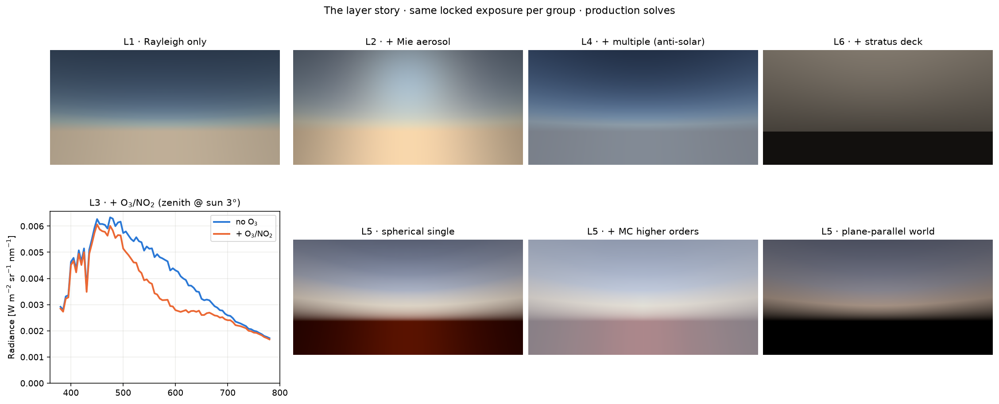

# 主线阶梯：从最简物理逐层逼近被测量的天空

本文按**递进叙事**组织：从纯 Rayleigh 平面一次散射出发，每层只叠加一个要素，
逐层走到与真实观测对表的边界。它与按**组件**组织的
[近似图](APPROXIMATIONS.md) 互补：那里回答"同一目标有哪些有限分支、各分支
换了什么"，这里回答"每叠加一个要素，天空的哪个可见性质变了、为什么"。
近似契约（`spherical-single` / `plane-sos` / `hybrid-sos` / `spherical-mc`）
的定义单源在近似图，本文只使用不复制。

每层的插图与数据由当前生产代码经统一入口（`rt.solver.solve` /
`render.solve_dome`）真实算出，全部来自
[layerstory 主题](../../experiments/layerstory/README.md) 的 11 次生产 solve
（10 确定性 + 1 MC 单 seed；提交的 NPZ 可无求解重画）；完整场景参数、网格、
定标记录与调用日志以主题 README 和其 `data/layers.md` 为单源，本文不复制
第二份配置表。

## 读图约定

- **对照协议**：每层的"可见差异"都有明确的差异基线——L2 复用 L1 的 solve；
  L3/L4 各自把上一层介质在**本层场景**重解一次（桥接态）；L5 的归因在 −4°
  场景**内部**完成（single vs MC vs 平面世界，单一变量）；L6 用契约匹配的
  同场景 clear/cloud 对。因此每张对比图都是同场景、单变量，可归因。
  唯一例外是 L5→L6：跨场景且物理主题不同，声明为叙事性过渡，不做配图 diff。
- **不提供跨要素加和**：多次散射对光学厚度组成是非线性的，"L1+L2 的贡献"
  没有物理意义；closure 只在单次 solve 内部成立（分量加和与三组桥接恒等式，
  逐位断言，见主题 README）。
- **展示**：三组锁定曝光（日景/云 0.03、暮光 10.0，ACES、无色适应、无太阳
  标记），组内无逐图自动提亮；日景与暮光 `ground=False`，云组 `ground=True`
  （阴天地板是叙事的一部分）。渲染图地平以下的像素是生产显示行为（穹顶
  采样在地平处的截断外推），不表示地面物理。

总览图（每层一个面板）：



---

## L1 — 纯 Rayleigh：蓝天从哪里来

**新增物理**：只有分子散射（US1976 空气，O₃=NO₂=0、无气溶胶），平面平行
一次散射（`plane-sos`，`single=True, multiple=False`），太阳 30°。分子散射
效率 ∝ λ⁻⁴，短波被散射出光束的几率约为长波的 (700/400)⁴ ≈ 9 倍。

**可见差异**（叙事起点，无基线）：天顶光谱在 420–680 nm 的对数斜率
**−3.74**——接近理想的 λ⁻⁴ 着色；近地平（86.25°）斜率仅 **−1.23**：视线
穿过的大气柱变厚，蓝光在途中已被散射殆尽（光学厚度饱和），地平因此泛白。
一天中最蓝的方向是天顶、最白的是地平，这一个斜率差就是原因。

**可解释**：蓝天、地平白化、为什么落日方向的天空偏黄红（光路变长）。

## L2 — +Mie 气溶胶：日周光晕与白化

**新增物理**：叠加 Hinterland 边界层气溶胶（AOD550=0.05，指数廓线 H=1.5 km），
其余同 L1。气溶胶颗粒远大于可见光波长，散射**接近光谱中性**且**强烈前向**。

**与上一层的可见差异**（基线 = L1 态 @30°，复用 solve）：向日侧 45° 高度
亮度 **×3.92**——太阳周围出现明亮的光晕（日周光晕）；近地平 **×2.59**，
绿红端抬升强于蓝端（对照谱图），天空整体发白。

**如实声明的表示极限**：气溶胶相函数的前向峰比任何有限矩表示更陡，生产用
delta-M 折矩把前向峰摊开——光晕的**角宽和近太阳亮度是矩截断下的近似**，
这是 `plane-sos`/`hybrid-sos` 的共同属性。机制见
[气溶胶方法](AEROSOL.md)；本层不为此换成员或调矩数。

**可解释**：霾天发白、太阳周围光晕、能见度与 AOD 的关系。

## L3 — +O₃/NO₂：Chappuis 带与"蓝色时刻"的入口

**新增物理**：在 L2 介质上叠加 O₃ 300 DU 与 NO₂ 柱量 4×10¹⁹ m⁻²（文献典型
范围 2–6×10¹⁵ cm⁻² 的中值；NO₂ 无生产先例，取值依据与可见性核查记录在
主题 README）。场景切到太阳 3°，一次散射（`plane-sos` single-only）。
臭氧在 500–700 nm 有 Chappuis 吸收带——恰好压在天空光谱最亮的绿红区。

**与上一层的可见差异**（基线 = L2 介质 @3° 重解的桥接态）：天顶光谱在
560–610 nm 被压到无 O₃ 时的 **0.674**、600–650 nm **0.724**，而蓝端
（440–490 nm）几乎不动（0.951）——谱形被"挖"出一个以绿红为主的凹槽，
低太阳天空因此从白转向蓝。NO₂ 在同一观察量下的贡献不超过 **~3%**（谱最大
相对变化，探针核查），如实记录为次要项，不放大。

**可解释**：Chappuis 带是"清洁大气低太阳偏蓝"的主要化学成因。完整的
**蓝色时刻**（太阳地平下、天空深蓝）需要暮光几何——那是 L5 的能力，
本层不提前引入。

## L4 — +多次散射：离太阳 90° 的天空不黑

**新增物理**：介质冻结（= L3 态），打开第二阶以上散射（`plane-sos`，
`single=True, multiple=True`），太阳回到 30°。一次散射只服务被太阳直接
照亮的路径；高阶项把被散射过的光再散射，把能量搬进直射阳光照不亮的角落。

**与上一层的可见差异**（基线 = 同介质 @30° single-only 桥接态）：反太阳侧
550 nm 处多次散射贡献占总亮度的 **24%**（天顶）、**34%**（反日侧 45°）、
**37%**(反日侧近地平 86.25°)——离太阳 90° 的天空不黑，全是高阶项填的。
反太阳侧谱（对照谱图）整体被抬升，且抬升在**蓝端相对最显著**：420 nm 处
多次散射占该方向亮度的 50%，沿波长单调衰减至 750 nm 的 24%，合成色度因此
向蓝移动（45° 反日 xy 0.251/0.264 → 0.236/0.241）。

**可解释**：背对太阳时天空依然明亮、影子内部的漫射照明。
"multiple" 是生产分量定义（总量减一次项，含各求解器处理的地面返回），
不是"恰好两次散射"的精确识别——语义单源见[近似图](APPROXIMATIONS.md)。

## L5 — +球面几何与折射：真暮光

**新增物理**：介质不变，场景切到太阳 **−4°**（地平下），输运几何从平面
平行换成球面：`spherical-single` 基线、`spherical-mc`（split estimator，
低质量单 seed，定性）与 `plane-sos`（平面世界对照）三态同场对比。太阳落到
地平下后，平面世界没有任何机制让它"渐暗"——而球面几何里，光线弦长、地影
边界和折射把照亮区从地面抬到高层大气，暮光出现了。太阳侧折射生产默认开启
（弦长修复见[折射方法](REFRACTION.md)，不在此重复）；本文的暮光对照是
**输运几何的跃迁**，不出折射 on/off 对照图。

**场景内的可见差异**（基线 = `spherical-single` @−4°）：

- 高阶散射填充：MC 加入后天顶亮度 4.41 → **6.08 cd m⁻²**（+38%）；严格
  地平（90° 天顶节点）向日侧 550 nm 从 2.70×10⁻⁵ 抬到 **2.58×10⁻⁴**，
  反日侧从**精确零**到 1.35×10⁻⁴——暮光的"底光"几乎全是高阶项。
- **平面世界没有暮光几何**：契约并不拒绝 `plane-sos` @−4°，它实跑且物理
  可判读——这正是最有教学价值的部分。平面几何用连续柱透射
  e^(−τ/|μ₀|) 处理地平下的太阳：高层大气仍被"照亮"，所以它的**天顶量级
  能碰对**（550 nm 5.887×10⁻⁵ vs 球面 5.870×10⁻⁵，×1.003）；但角向结构
  全错——严格地平处精确为零、没有地影、没有贴着地平的暮光弧。总览图下排
  第 2 / 第 4 面板：球面 single 的亮带贴着地平，平面世界把亮光挂在天顶附近。
  **单点量级对不等于几何对**，这是本层最重要的教训。

**可解释**： civil twilight 的渐暗过程、暮光弧为什么贴着地平、为什么深暮光
需要球面引擎（引擎与预算边界见[暮光专题](../twilight/README.md)）。

## L6 — +云：云白与阴天地板

*（自 L5 而来是叙事性过渡：跨场景且物理主题不同，本层不做与上一层的配图
diff；层内差异由契约匹配对归因。）*

**新增物理**：回到太阳 30°，在冻结局上叠加 `cloud.stratus()` 水云层
（τ550=20，底 0.5 km、顶 1.5 km），经 `cloud_layer` 以 `hybrid-sos` 契约
overlay（生产契约：overlay 只与 `hybrid-sos` 组合，观察者必须在云底之下，
机制见[云方法](CLOUD.md)）。渲染组切到 `ground=True`：阴天地板（云下地面
照明）进入画面。

**与基线的可见差异**（基线 = 同场景 `hybrid-sos` clear，新 solve，契约匹配）：
云下天顶全谱亮度 **×4.7**（Lv 1355 → 6430 cd m⁻²；550 nm 谱辐射比 ×4.70），
且谱形被抹平——460–740 nm 相对平坦度仅 **0.068**：厚云把有颜色的天空散射
成了白色的光。地面从晴天的日照对比变成昏暗均匀的漫射照明（对比总览图第四
面板的深色地板）。

**可解释**：阴天为什么白且亮、云下为什么没有影子、为什么阴天色调"平"。

## L7 — 与观测对表：诚实的边界

本层不做新计算，把前六层放到观测面前，引用既有验证证据（不复制证据链）：

- 六项物理校验的最新提交基线是 **2 PASS / 4 FAIL**（见
  [STATUS](../STATUS.md) validation snapshot 与
  `validation/results.json`）：Rayleigh 光学深度 vs Bodhaine 通过；
  **直射/漫射照度 vs CIE 110 失败**（DNI +4–6%，DHI +41–46%）；**CIE 相对
  亮度分布失败**（上空 RMS 10.6%、向日地平 +142%）；**Koomen 暮光失败**
  （−6° 确定性 0.55×）。也就是说：本阶梯的**谱形与色度叙事**有独立核查，
  **绝对亮度分布**还没有。
- 统一太阳源的已知偏差（深暮光记录性、dome 5.9–6.6× 等）逐条带实测值与
  裁决记录在 [SOLAR_SOURCE.md §Known deviations](SOLAR_SOURCE.md)。
- 观测算子与"哪些用途有条件可用/绝对辐照度不可裁决"的裁定在 CSSP 冻结包
  （`validation/` 与 [第二数据集](../../validation/SECOND_DATASET.md)）；
  深暮光数字的性质（budget-limited，非收敛预测）见
  [深暮光参考](../twilight/DEEP_TWILIGHT_REFERENCE.md)。

主线一句话：**这架梯子解释"颜色从哪来"是可信的；把任何一格读成"绝对亮度
的预测"，先去读上面三份证据。**

---

## 架构反馈

**无**。七层全部经现有 `Medium`/`Scene` 构造与四近似契约干净表达，
`skycolor/` 零 diff。逐层依据：`ozone_du=0` 归零 O₃、`no2_column` 直接可用
（内建廓线按柱量归一）、`aerosols=()` 为默认、`single/multiple` 阶选择在
`solve` 一等可达、`spherical-single`/`spherical-mc` 接受负太阳角实跑通过、
`plane-sos`/`hybrid-sos` @−4° 不被拒绝（产出物理可判读的"平面世界"）、
`cloud_layer` overlay 契约（hybrid-sos + 观察者低于云底）原样可用。
唯一的表述级发现已写进 L5：**契约不拒绝平面族在地平下运行**——它不构成
缺陷（输出物理可判读且恰好是教学素材），但消费方应知道"跑通"不等于
"物理适用"。

## 复现

```bash
# 全阶梯：11 次生产 solve（10 确定性 + 1 MC 单 seed），写主题 out/ 与 figures/
uv run python -m experiments.layerstory.layer_story
# 从提交的数据无求解重画正式图（含发布到根 figures/）
uv run python -m experiments.layerstory.layer_story \
  --from-npz experiments/layerstory/data/layer_story.npz --publish-figures
```

每层的介质/场景/近似/网格参数单源在
[layerstory 主题 README](../../experiments/layerstory/README.md)；提交的
`data/layer_story.npz` 用普通 `np.load(..., allow_pickle=False)` 即可回读。
本文引用的全部数字来自该 NPZ 对应的调用记录（`data/layers.md`，含采用版本）。
