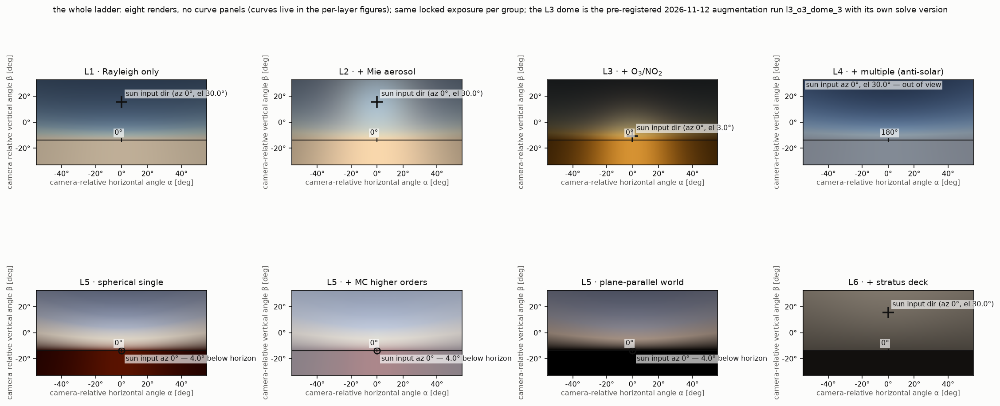
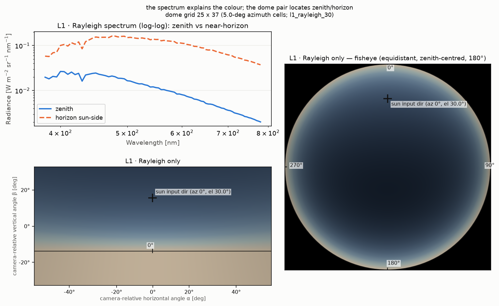
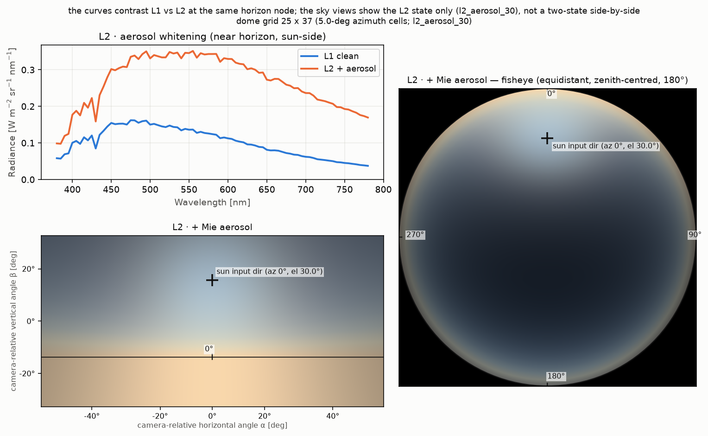
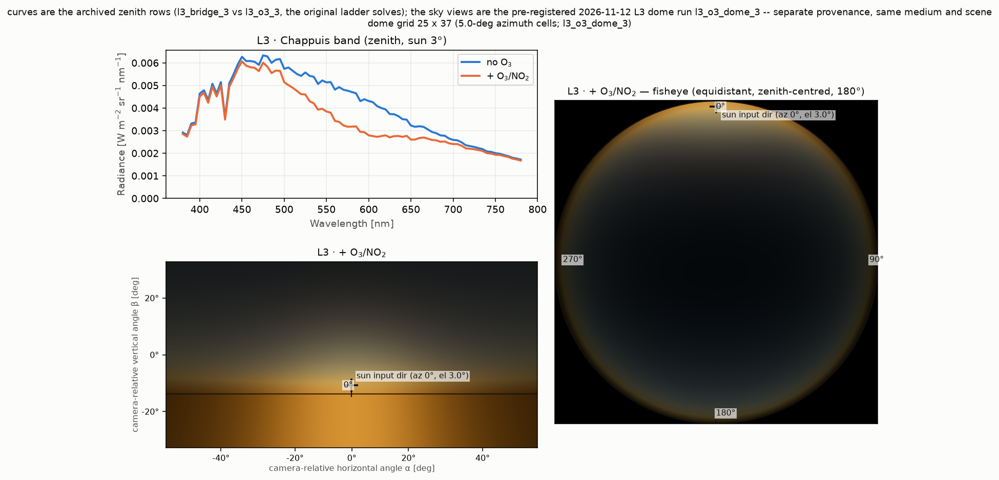
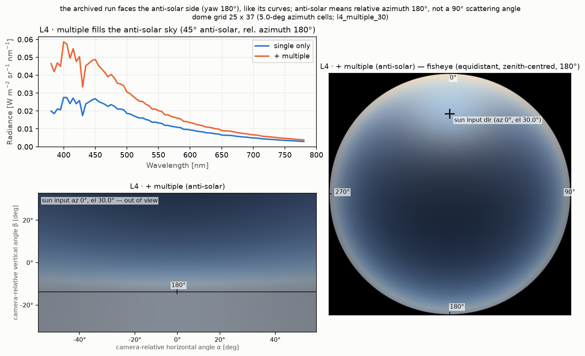
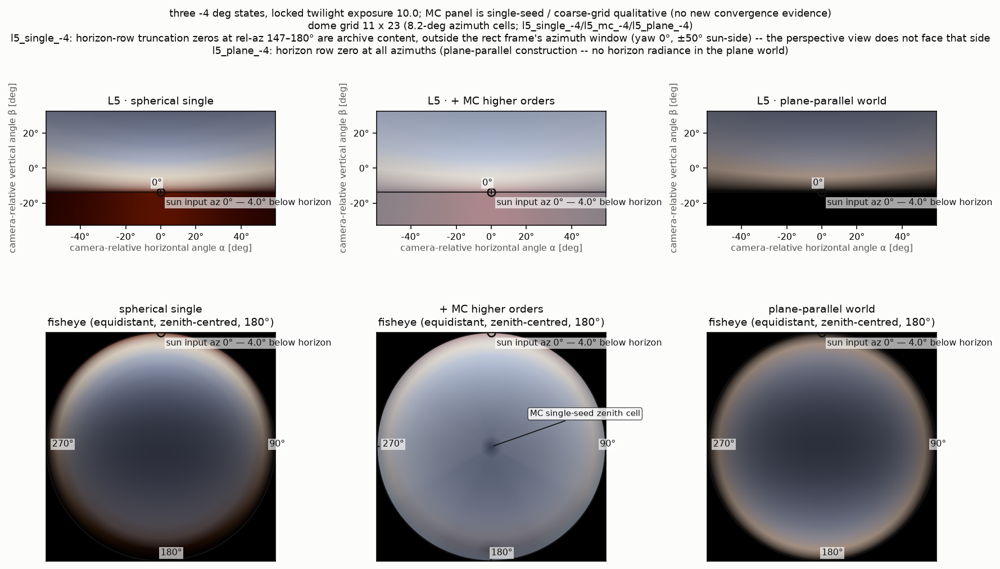
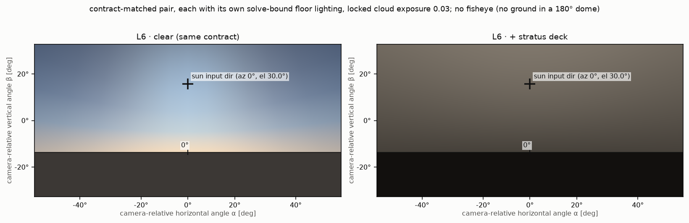
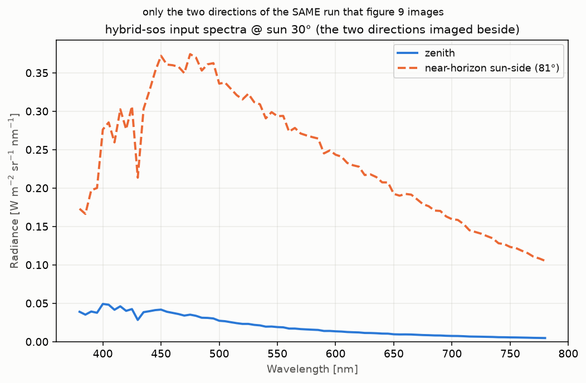
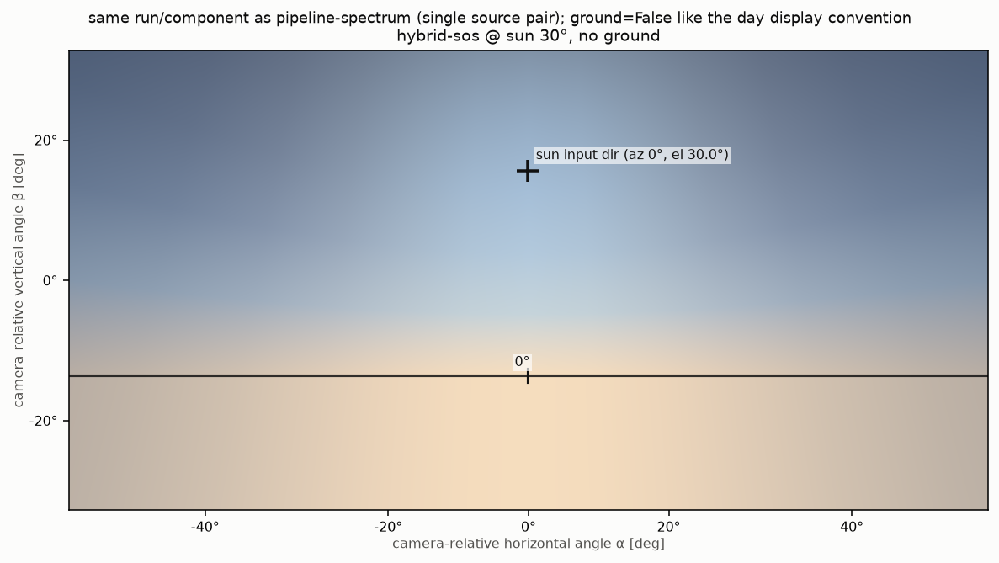
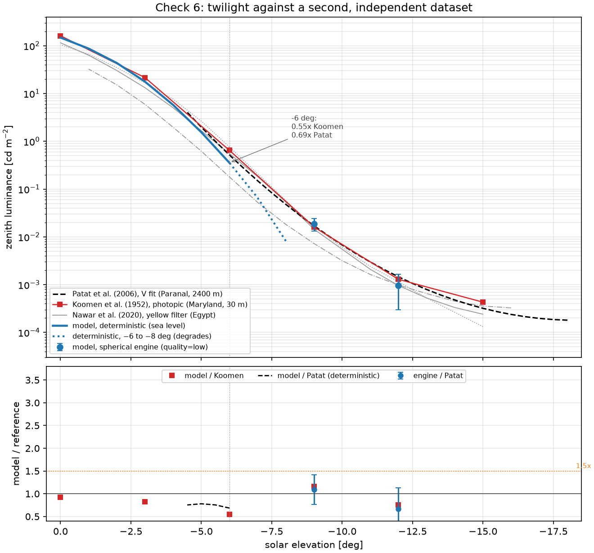

# 天空颜色主线：从最简物理到你看到的图

**分工声明**：本文是这个模拟器的**读者级主线**——从"为什么天空是蓝的"这类问题
出发，按从粗到细的顺序把模型走一遍，每章配上可追溯的图。它有一篇证据级的
姊妹篇[层阶梯叙事](LAYER_STORY.md)：那里每个可见差异都对着锁定的对照基线归因，
全部数字与提交数据逐条对账。两篇共用同一套结论，**数字单源**在 LAYER_STORY
及其数据档案——本文只叙事、不复制它的数字；审计细节（读图约定、closure
恒等式、锁定曝光的推导）一律以链接承载，不在正文复制。

## 1. 总览：这个模拟器算什么

它从第一性原理计算天空：给定大气成分和太阳位置，算出每个波长、每个方向上
天空有多亮（光谱辐亮度，单位 W m⁻² sr⁻¹ nm⁻¹），再把光谱变成人眼看到的颜色
和图像。不拟合照片，也不查经验色卡——空气怎么散射、臭氧怎么吸收、云怎么
反光，全部从物理模型推出来。

一条生产流程（形态与[中文摘要](../SUMMARY.zh.md)一致）：

```text
Medium（大气介质）+ Scene（观察场景）+ 折射前太阳方向
  → rt.solver.solve（四种有限近似之一，一次求解）
  → SkyResult（光谱、分量、有效设置）
  → CIE 色度 → 可选色适应 → ACES tone mapping → 图像
```

能力与边界先用一句话说清：这套模型解释"颜色从哪来"（谱形与色度）已有独立
核查，但**绝对亮度分布**还没有——把任何一格读成亮度预测之前，先读第 7 章。
细节与当前结论见[层阶梯 L7](LAYER_STORY.md) 与 [STATUS](../STATUS.md)。

想按需深入，路线图如下（全文只有一个路线图，就在这里）：

- 想要**证据级细节**（每层怎么归因、断言怎么对账）→ [LAYER_STORY](LAYER_STORY.md)
- 想理解**近似分支的语义**（四种近似各换了什么）→ [近似图](APPROXIMATIONS.md)
- 想知道**当前行为与验证边界**（哪些过了、哪些没过）→ [STATUS](../STATUS.md)
- 想找**图与复现命令** → [图录](../../figures/README.md)

下面是本文的主图：2×4 八张渲染——上排 L1 / L2 / L3 / L4，下排 L5 三态与
L6 云——**没有曲线面板**，每层的光谱曲线由第 2–3 章的专属谱图承载。它们
不是示意图——每一个面板都来自生产代码的一次真实求解（L3 穹顶是一次
预注册的增补求解，出处见 [LAYER_STORY](LAYER_STORY.md)）。本章只看一点：
这就是整条管线的最终输出。



**图 1 · 八渲染全貌（2×4，无曲线面板）。** 上排：L1 纯 Rayleigh / L2 加
气溶胶 / L3 加 O₃+NO₂（dome）/ L4 加多次散射（反日侧）；下排：L5 暮光
三态（球面一次 / MC 高阶 / 平面世界）与 L6 云。面板组织与读图约定的单源在
[LAYER_STORY 读图约定](LAYER_STORY.md)。本章看点：整条管线的最终输出。

## 2. 蓝天：最简模型

为什么天空是蓝的？为什么越靠地平越白？

最简模型只保留一样物理：空气分子的散射（Rayleigh 散射），加上平面平行的
简化几何。分子散射有个关键脾气：**波长越短，散射越强**——蓝光比红光容易
被散射得多（定量关系见 [L1](LAYER_STORY.md)）。

于是：

- 看天顶时，视线穿过的大气柱最薄，大量蓝光被散射进眼睛——天顶最蓝。
- 看地平时，视线斜着穿过厚得多的大气柱，蓝光在路上已经被散射得差不多了，
  剩下来的光偏白——地平发白。

一天之中最蓝的方向是天顶、最白的方向是地平，原因就是这一个斜率差。
下图是本层的专属图：对数坐标下，天顶与近地平两条谱线一陡一缓，就是上面
两句话的定量形状（具体数字不在这里复制，见 L1）。



**图 2 · L1 专属图（`rayleigh`）：左上，天顶与近地平（86.25° 向日侧）谱
（log-log）；左下，透视渲染；右列，同场 180° 等距鱼眼（天顶居中）。**
本章看点：两条谱线的斜率差就是“天顶蓝、地平白化”的定量形状；鱼眼把
天顶/地平放进整个上半穹顶定位。图中地平线、方位刻度与太阳方向标注由
同一相机网格计算得出，太阳只标折射前输入方向、不画日面；渲染面板的
坐标轴是存档相机参数经 pinhole 映射导出的**相机相对角 α/β**（相对光轴，
非世界方位/仰角），地平与太阳标注仍是绝对方向。

## 3. 逐层要素：气溶胶 → 臭氧 → 多次散射

真实大气不只有空气分子。先交代证据级文档的一个重要做法：每加一样要素，
都把上一层的介质在新场景里重解一次作对照，所以每张对比图都是同场景、
单变量，差异可以归因到刚加的那一样东西（对照协议见
[LAYER_STORY 读图约定](LAYER_STORY.md)）。本章按同样顺序走，每小节回答
一个"为什么"。

### 3.1 气溶胶：日周光晕与整体发白

霾天为什么发白？太阳周围为什么有一圈亮晕？

气溶胶是悬浮在大气里的细小颗粒。它们的粒径与可见光波长同量级（处在 Mie
散射区），散射起来有两个脾气：几乎**不挑颜色**（谱接近中性），而且
**强烈前向**（把光朝原来的方向推）。前者解释了为什么加气溶胶后天空整体
发白而不是变色；后者解释了太阳周围那圈明亮的日周光晕。

一个如实的注脚：气溶胶的前向峰比任何有限阶的数学表示都陡，生产代码用
delta-M 把峰"摊开"——所以光晕的角宽和近太阳亮度是近似值，机制见
[气溶胶方法](AEROSOL.md)。



**图 3 · L2 专属图（`aerosol`）：左上，近地平（86.25° 向日侧）同场谱
对照；左下与右列为 L2 态（`l2_aerosol_30`）的透视/鱼眼视图。**
本章看点：加气溶胶后（橙）相对清洁大气（蓝）整体抬升，且绿红端抬得比蓝端
更多——谱不挑颜色加上总量抬升，就是“发白”的形状；天空视图呈现的是
叠加气溶胶后的状态，两态对比由谱承载。

### 3.2 臭氧：低太阳偏蓝的化学成因

太阳贴近地平的时候，天空为什么反而偏蓝？

没有臭氧时，低太阳的天空是发白的（前面两节的机制还在）。臭氧在绿红波段
有一条吸收带（Chappuis 带）——位置恰好压在天空光谱最亮的区域，把谱形
"挖"出一个以绿红为主的凹槽，天空于是从白转向蓝。同场存在的 NO₂ 的贡献
是次要项（证据级文档如实记录了它的量级，见 [L3](LAYER_STORY.md)），本文
不放大。

注意这一层只是"入口"：完整的**蓝色时刻**（太阳已落到地平之下、天空深蓝）
还需要暮光几何——那是第 4 章的能力，本层不提前引入。



**图 4 · L3 专属图（`ozone`）：左上，太阳 3° 天顶谱对照（无 O₃ 桥接态 vs
+O₃/NO₂，原阶梯两次 solve）；左下与右列的天空视图来自一次预注册增补
solve（`l3_o3_dome_3`，逐 run 出处见 [LAYER_STORY](LAYER_STORY.md)）。**
本章看点：加 O₃/NO₂ 后（橙）相对无臭氧（蓝）在绿红区被
压低——谱形被“挖槽”，这就是低太阳偏蓝的主要化学成因。

### 3.3 多次散射：离太阳 90° 的天空不黑

背对太阳看天空，那里没有直射阳光，为什么依然亮？

因为光会被散射不止一次。一次散射只服务被太阳直接照亮的路径；被散射过的
光还会再被散射，高阶项就这样把能量一点点搬进直射阳光照不亮的角落。
反日侧的天空不黑，靠的全是这些高阶项。

还有个细节值得看：多次散射的抬升在**蓝端相对最显著**，所以反日侧的色度
整体向蓝移动（定量见 [L4](LAYER_STORY.md)）。

一个语义注脚：生产代码里的 "multiple" 是"总量减一次项"的分量定义（含各
求解器处理的地面返回），不是"恰好两次散射"的精确识别——语义单源在
[近似图](APPROXIMATIONS.md)。



**图 5 · L4 专属图（`multiple`）：左上，45° 反日侧（相对太阳方位 180°）
同场谱对照；左下与右列为反日朝向（yaw 180°）的透视/鱼眼视图。** 本章
看点：+multiple（橙）相对一次散射（蓝）整体抬升、蓝端相对
抬得更多——“离太阳 90° 的天空不黑”就是这些高阶项填出来的。

## 4. 几何与暮光：太阳落到地平下之后

太阳落到地平线以下，天为什么还亮着？又为什么渐渐暗下去？

先把地球当成平面，问题就没有答案了：平面几何里，太阳落到地平下之后没有
任何机制让天空"渐暗"——它的天顶亮度甚至能碰对（数字见
[L5](LAYER_STORY.md)），但角向结构全错：严格地平处精确为零、没有地影、
没有贴着地平的暮光弧。

换成球面几何，暮光出现了：视线的弦长、地影的边界和折射一起，把被照亮的
区域从地面抬到高层大气。civil twilight 的渐渐变暗、暮光弧贴着地平的
形状，都是这个几何的直接结果。还有一件值得看的事：暮光的"底光"几乎全是
高阶散射填的——加入 MC 高阶后，天空被进一步点亮（数字见 L5）。

生产代码里太阳侧折射默认开启（弦长几何见[折射方法](REFRACTION.md)，本文
不重复其修复历史）；更深的暮光需要专门的球面引擎与计算预算（见
[暮光专题](../twilight/README.md)）。



**图 6 · L5 专属图（`twilight`）：−4° 暮光三态（球面一次 / +MC / 平面
世界），每态透视与 180° 等距鱼眼同场配对、组内锁定曝光。** 本章看点：
球面 single 的亮带贴着地平，平面世界把亮光挂在天顶附近——**单点量级对，
不等于几何对**（这是 L5 最重要的教训，原文见 [L5](LAYER_STORY.md)）。
MC 面板是单 seed / 粗网格的定性记录，不是收敛证据；太阳在地平下，图中
只给 az 0° 的地平下指示，不画日面。

## 5. 云：阴天为什么白

回到晴天场景、太阳升高，在冻结的大气上叠一层水云（厚层云，参数见
[L6](LAYER_STORY.md) 与[云方法](CLOUD.md)）。同一场景叠上云后，天顶亮度
不降反升（数字见 L6），而且谱形被抹平——厚云把有颜色的天空散射成了白色
的光，所以阴天的色调是"平"的白。同时云底把阳光变成昏暗均匀的漫射照明
洒到地面：云下没有影子，日照对比也没了——这就是阴天地板（对比下图地面
那条深色带）。

一个契约注脚：生产代码里云以 overlay 进入，只与默认的 hybrid-sos 组合，
且观察者必须在云底之下（机制见[云方法](CLOUD.md)）。



**图 7 · L6 专属图（`cloud`）：契约匹配的 clear / 云两面板，同相机、同
锁定曝光，地面照明均为各自 solve 绑定材料。** 本章看点：白色天空之下
那条深色的地面——阴天地板是叙事的一部分（地面照明开着，见
[LAYER_STORY 读图约定](LAYER_STORY.md)）；左面板的日照地板就是"从晴天
到阴天"的对照基线。

## 6. 颜色管线：从光谱到你看到的图

光谱算出来之后，怎么变成你看到的颜色和图？

一条颜色管线把光谱变成像素：人眼的三种感光曲线（CIE 颜色匹配函数）先把
光谱加权成三个数（XYZ 色度），可选做一步色适应（模拟人眼对光照环境的
适应），再用 tone mapping 把物理亮度压进显示设备能表现的范围，最后按
相机参数（透视投影、俯仰角、水平视场角）成像。契约与模块边界见
[架构文档](../ARCHITECTURE.md)与 [STATUS](../STATUS.md)。

读图前还有一组显示约定要先说清：本文引用的**渲染图**都用锁定曝光——
同一组图共享同一个曝光值，没有逐图自动提亮；曝光和白平衡只改变显示，
不改变物理谱，也不能替代准确度证据。除非面板明确画了地面（如云面板的
阴天地板），渲染图中地平线以下的像素是渲染器的显示约定，不是物理算出的
地面。

两张图对照着看：



**图 8 · 颜色管线之前：进入图 9 同一场的两个方向谱**（hybrid-sos、太阳
30° 晴天场景；天顶与近地平向日侧 81°——这两条谱就是成像的直接输入，
与图 9 同一 run 单源）。出处与参数：[layerstory 主题](../../experiments/layerstory/README.md)
与[图录](../../figures/README.md)。



**图 9 · 颜色管线之后：图 8 同一 run 的 total 谱经 CIE 色度与 tone
mapping 后的透视成像。** 本章看点：谱→图对照——图 8 的光谱经过管线后
落到这里的颜色。图中地平线与太阳方向为计算标注（折射前输入方向，非日面）；
锁定曝光与显示参数的记录单源在[图录](../../figures/README.md)。

## 7. 验证故事：怎么知道它是对的

前面每一章都在说"证据级文档对过账"——对的是什么账？

模拟器面对一组对照公开文献与观测数据集的物理校验（六项 check，覆盖
Rayleigh 光学厚度、直射/漫射照度、相对亮度分布、色度、暮光）。诚实账本
的现状是 **3 PASS / 3 FAIL**：谱形、照度与色度的叙事有独立核查撑腰，
**亮度分布与暮光的绝对量**还有未关闭的缺口。每一项的数字、失败模式与最新提交基线，单源在
[STATUS](../STATUS.md) 的 validation snapshot 与
[results.json](../../validation/results.json)，本文不复制第二份清单。

下面这张 check6 对比图就是验证故事的对象：模型对着三份独立的暮光观测
数据集对表。



**图 10 · 观测数据集对照（check6 用图）。** 上：天顶亮度随太阳高度角的
衰减，模型与三份独立观测；下：模型/观测比值面板。出处与判读单源：
STATUS validation snapshot 与[第二数据集](../../validation/SECOND_DATASET.md)。

已知偏差同样诚实入账：统一太阳源的已裁决残差逐条带实测值记录在
[SOLAR_SOURCE.md §Known deviations](SOLAR_SOURCE.md)；深暮光引擎点是低
预算单个种子的记录性结果，不是收敛预测（见 STATUS）。

主线一句话（语义引自 [L7](LAYER_STORY.md)）：**这架梯子解释"颜色从哪来"
是可信的；把任何一格读成"绝对亮度的预测"之前，先去读它指向的证据。**
想继续深入，回到第 1 章末尾的读者路线图——本文到此收尾。
