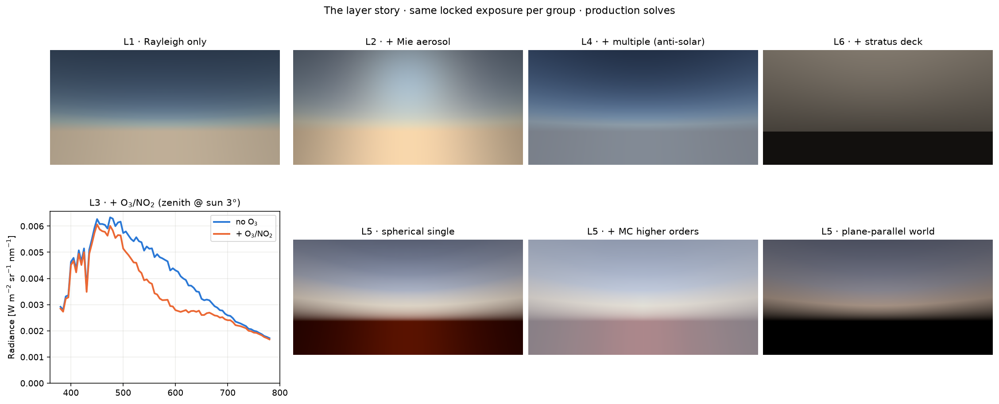
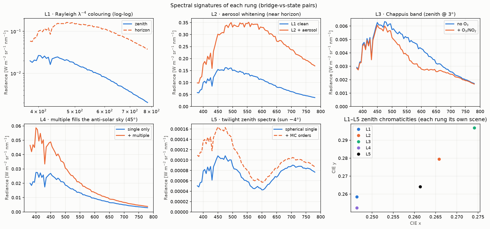

# 天空颜色主线：从最简物理到你看到的图

**分工声明**：本文是这个模拟器的**读者级主线**——从"为什么天空是蓝的"这类问题
出发，按从粗到细的顺序把模型走一遍，每章配上真实算出的图。它有一篇证据级的
姊妹篇[层阶梯叙事](LAYER_STORY.md)：那里每个可见差异都对着锁定的对照基线归因，
全部数字与提交数据逐条对账。两篇共用同一套结论，**数字单源**在 LAYER_STORY
及其数据档案——本文只叙事、不复制它的数字；审计细节（读图约定、closure
恒等式、锁定曝光的推导）一律以链接承载，不在正文复制。

## 1. 总览：这个模拟器算什么

它从第一性原理计算天空：给定大气成分和太阳位置，算出每个波长、每个方向上
天空有多亮（光谱辐亮度，单位 W m⁻² sr⁻¹ nm⁻¹），再把光谱变成人眼看到的颜色
和图像。不拟合照片，也不查经验色卡——空气怎么散射、臭氧怎么吸收、云怎么
反光，全部从物理模型推出来。

一条生产流程（形态与[中文摘要](../SUMMARY.zh.md)一致）：

```text
Medium（大气介质）+ Scene（观察场景）+ 折射前太阳方向
  → rt.solver.solve（四种有限近似之一，一次求解）
  → SkyResult（光谱、分量、有效设置）
  → CIE 色度 → 可选色适应 → ACES tone mapping → 图像
```

能力与边界先用一句话说清：这套模型解释"颜色从哪来"（谱形与色度）已有独立
核查，但**绝对亮度分布**还没有——把任何一格读成亮度预测之前，先读第 7 章。
细节与当前结论见[层阶梯 L7](LAYER_STORY.md) 与 [STATUS](../STATUS.md)。

想按需深入，路线图如下（全文只有一个路线图，就在这里）：

- 想要**证据级细节**（每层怎么归因、断言怎么对账）→ [LAYER_STORY](LAYER_STORY.md)
- 想理解**近似分支的语义**（四种近似各换了什么）→ [近似图](APPROXIMATIONS.md)
- 想知道**当前行为与验证边界**（哪些过了、哪些没过）→ [STATUS](../STATUS.md)
- 想找**图与复现命令** → [图录](../../figures/README.md)

下面是本文的主图：八面板，上排四张渲染、下排一张天顶谱加三张暮光渲染。
它们不是示意图——每一个面板都来自生产代码的一次真实求解。本章只看一点：
这就是整条管线的最终输出。



**图 1 · 八面板全貌。** 上排：L1 纯 Rayleigh / L2 加气溶胶 / L4 加多次散射
（反日侧）/ L6 加云层；下排：L3 天顶谱与 L5 暮光三态（球面一次 / MC 高阶 /
平面世界）。面板组织与读图约定的单源在
[LAYER_STORY 读图约定](LAYER_STORY.md)。本章看点：整条管线的最终输出——
后文每章都会回来取其中一块。

## 2. 蓝天：最简模型

为什么天空是蓝的？为什么越靠地平越白？

最简模型只保留一样物理：空气分子的散射（Rayleigh 散射），加上平面平行的
简化几何。分子散射有个关键脾气：**波长越短，散射越强**——蓝光比红光容易
被散射得多（定量关系见 [L1](LAYER_STORY.md)）。

于是：

- 看天顶时，视线穿过的大气柱最薄，大量蓝光被散射进眼睛——天顶最蓝。
- 看地平时，视线斜着穿过厚得多的大气柱，蓝光在路上已经被散射得差不多了，
  剩下来的光偏白——地平发白。

一天之中最蓝的方向是天顶、最白的方向是地平，原因就是这一个斜率差。
下图只取证据级谱图中 L1 的那块面板：对数坐标下，天顶与近地平两条谱线
一陡一缓，就是上面两句话的定量形状（具体数字不在这里复制，见 L1）。



**图 2 · 仅取上排第一面板（L1·Rayleigh λ⁻⁴ colouring，log-log）。**
本章看点：天顶与近地平两条谱线的斜率差——对数斜率就是"天顶蓝、地平白化"
的定量形状。

## 3. 逐层要素：气溶胶 → 臭氧 → 多次散射

真实大气不只有空气分子。先交代证据级文档的一个重要做法：每加一样要素，
都把上一层的介质在新场景里重解一次作对照，所以每张对比图都是同场景、
单变量，差异可以归因到刚加的那一样东西（对照协议见
[LAYER_STORY 读图约定](LAYER_STORY.md)）。本章按同样顺序走，每小节回答
一个"为什么"。

### 3.1 气溶胶：日周光晕与整体发白

霾天为什么发白？太阳周围为什么有一圈亮晕？

气溶胶是悬浮在大气里的细小颗粒。它们比可见光波长大得多，散射起来有两个
脾气：几乎**不挑颜色**（谱接近中性），而且**强烈前向**（把光朝原来的方向
推）。前者解释了为什么加气溶胶后天空整体发白而不是变色；后者解释了太阳
周围那圈明亮的日周光晕。

一个如实的注脚：气溶胶的前向峰比任何有限阶的数学表示都陡，生产代码用
delta-M 把峰"摊开"——所以光晕的角宽和近太阳亮度是近似值，机制见
[气溶胶方法](AEROSOL.md)。


**图 3 · 仅取上排第二面板（L2·aerosol whitening，near horizon）。**
本章看点：加气溶胶后（橙）相对清洁大气（蓝）整体抬升，且绿红端抬得比蓝端
更多——谱不挑颜色加上总量抬升，就是"发白"的形状。

### 3.2 臭氧：低太阳偏蓝的化学成因

太阳贴近地平的时候，天空为什么反而偏蓝？

没有臭氧时，低太阳的天空是发白的（前面两节的机制还在）。臭氧在绿红波段
有一条吸收带（Chappuis 带）——位置恰好压在天空光谱最亮的区域，把谱形
"挖"出一个以绿红为主的凹槽，天空于是从白转向蓝。同场存在的 NO₂ 的贡献
是次要项（证据级文档如实记录了它的量级，见 [L3](LAYER_STORY.md)），本文
不放大。

注意这一层只是"入口"：完整的**蓝色时刻**（太阳已落到地平之下、天空深蓝）
还需要暮光几何——那是第 4 章的能力，本层不提前引入。


**图 4 · 仅取上排第三面板（L3·Chappuis band，zenith @ 3°）。**
本章看点：加 O₃/NO₂ 后（橙）相对无臭氧（蓝）在绿红区被压低——谱形被
"挖槽"，这就是低太阳偏蓝的主要化学成因。

### 3.3 多次散射：离太阳 90° 的天空不黑

背对太阳看天空，那里没有直射阳光，为什么依然亮？

因为光会被散射不止一次。一次散射只服务被太阳直接照亮的路径；被散射过的
光还会再被散射，高阶项就这样把能量一点点搬进直射阳光照不亮的角落。
反日侧的天空不黑，靠的全是这些高阶项。

还有个细节值得看：多次散射的抬升在**蓝端相对最显著**，所以反日侧的色度
整体向蓝移动（定量见 [L4](LAYER_STORY.md)）。

一个语义注脚：生产代码里的 "multiple" 是"总量减一次项"的分量定义（含各
求解器处理的地面返回），不是"恰好两次散射"的精确识别——语义单源在
[近似图](APPROXIMATIONS.md)。


**图 5 · 仅取下排第一面板（L4·multiple fills the anti-solar sky，45°）。**
本章看点：+multiple（橙）相对一次散射（蓝）整体抬升、蓝端相对抬得更多——
"离太阳 90° 的天空不黑"就是这些高阶项填出来的。
