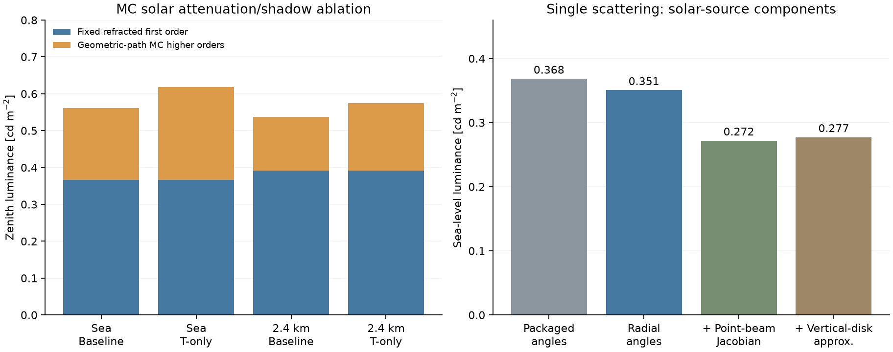

# 暮光太阳源审计：衰减、角度映射与光束定幅

2026-11-01；基线 `2d0294c`，实验工具提交 `af235a7`。
这是[海拔遮挡审计](TWILIGHT_ALTITUDE_AUDIT.md)之后的第二阶段。
本轮保留库的默认计算，新增可复跑实验工具和独立参考积分器。

> 阶段定位：下文“下一步”的统一源已由
> [阶段三](UNIFIED_SOLAR_SOURCE_AUDIT.md)完成实验验证，连续漫射传播见
> [阶段四](CURVED_TRANSPORT_AUDIT.md)。本报告保留阶段二消融与当时的未决边界，
> 不把局部实验效果当完整新模型；生产默认尚未替换。

## 结论

**已证实的太阳方向误差与源项敏感性已经足够大，应先于高阶求解器的大改或观测校准处理。**

- 只把现有折射太阳衰减/遮挡接入 MC，高阶量在海平面增加 **29.0%**、高站增加 **25.5%**。
  高站/海平面的混合总量比从 **0.9568±0.0071** 降到 **0.9292±0.0072**，不是自动达到某个
  跨站点目标。该消融完全保持漫射路径、几何 phase 和地面入射余弦不变。
- 当前太阳方向表存在逆插值精度缺口。原表节点可重生，但典型暮光点的方向闭合误差可达
  **0.1–0.3°**，更深点可到 0.37°；有些点会错判照明状态。
- 太阳输入是远场光谱辐照度，局地太阳源还需要折射的角域缩放。独立 RK4 与径向积分在
  38/40/47 km、真实太阳高度 −6° 给出点光束因子约 **0.617/0.651/0.693**。
- 在一次散射的受控实验中，精化方向并加入光束定幅后，海平面亮度从 **0.3684** 变为
  **0.2719 cd m⁻²**；有限日面的一维边际近似给 **0.2772**。这不是完整新天空模型，
  却足以否定“衰减处方产生的增亮就是完整折射增益”的解读。

本轮没有把这些实验数值写入默认模型或物理校验基准。局地 phase、完整二维有限日面、
太阳柱量离散误差和漫射路径折射仍需分别验证；一次项的比例不能直接乘到高阶项上。

## 1. MC 配对消融：隔离太阳衰减与遮挡

固定 clear、AOD₅₅₀=0.05、300 DU、地面反照率0.1、太阳真实高度−6°、天顶、
380–780 nm / 5 nm，种子100–107，每波长100,000条路径，地面0/2.4 km。
每个(height, seed)分别运行几何太阳源 G 与现有查表衰减/遮挡 T，总计259.2 million
wavelength-paths。没有角度平滑或光谱 anchor 插值。

T 替换每次太阳 next-event 的 apparent 方向、Bouguer invariant、太阳柱量和地面遮挡。
phase 仍用几何太阳方向，地面反射仍用几何太阳余弦，也没有光束角 Jacobian。
这回答的是“复制现有 single 的太阳衰减处方，MC 对此有多敏感”，而非完整折射传输。

工具在独立命名空间编译当前 tracer，只替换太阳透过率函数。两次运行对所有 NEE
位置数组累计 SHA256：**16/16 配对的调用点序列完全相同**。几何副本与原 public MC
逐位一致；本轮16个几何基线与上一轮的6个光谱字段也是全部逐位一致。

| 分量 [cd m⁻²] | 海平面 G | 海平面 T | 2.4 km G | 2.4 km T |
|---|---:|---:|---:|---:|
| MC 高阶项，含地面 | 0.195318 | 0.251914 | 0.145372 | 0.182462 |
| 固定当前折射一次项 + MC 高阶 | 0.561433 | 0.618029 | 0.537202 | 0.574292 |

高阶配对增量为海平面 **0.056596±0.000502**、高站 **0.037090±0.000584 cd m⁻²**。
对应增幅29.0%与25.5%。高度比变化为 **−0.027610±0.000485**；小误差来自真实配对路径，
不是假定不同高度同 seed 必有相同路径。这里所有 ± 仅为8组独立种子间的经验标准误，
不覆盖模型近似或极稀有尾部的未收敛风险。

T 模式 MC 一次项均值为0.371688±0.002128（海平面）、0.396465±0.001984（高站）。
现有确定性一次项随Gauss点数3→24为0.366115→0.368403、0.391830→0.393622。
两种估计的一次量仍有约百分之一的数值/统计差别，不能宣称完全等价；它不影响本次
保持路径的高阶源项差分。固定一次项的表格也不应被当作严格全阶一致的新物理结果。

## 2. 查表角度与柱量：两种误差可能抵消

独立探针通过向量 RK4 的最终出射方向，用 Brent 根求解匹配目标真实太阳方向；
另以四阶段 RK4 位置连续积分气体/气溶胶密度，不调用 shell 弦长公式。

例如海平面模型、z=38 km、真实太阳高度−6°：

- 查表给 apparent −5.428660°；正确 RK 根为−5.487343°。
- 查表方向实际射向真实高度约−5.906265°，偏离目标约0.094°。
- 550 nm 透过率，lookup + shell为0.034145，正确root + 连续RK为0.026162。

z=40 km 尤其说明了“净结果相近”不代表机制正确：
lookup + shell为0.043484，相同lookup方向的连续RK为0.052173，正确root + RK为0.042049。
方向偏亮与shell近似偏暗在这里部分抵消。

高地2.4 km、z=30 km的查表判暗，但真实root的perigee为2.808 km，光线未碰地面；
更深的太阳−9°、z=70 km也有类似错判。这不撤销阶段一的ground判据修复：本轮查的是
**输入给正确判据的 apparent 方向**，属于另一层误差。

原表若干节点重新生成的误差为微度级，RK柱积分步长2→1 km引起的T550相对变化小于
1.7×10⁻⁶，均远小于上述差别。局部精化pilot将−6°、30–50 km的方向误差从0.132°
降到约0.0042°；它只支持精化方向，不构成全域新LUT的认证。

## 3. 独立径向积分与光束因子

实验参考工具 `tools/radial_solar_mapping.py` 不使用 Cartesian RK4 来积分方向，而是利用
Bouguer invariant `a=n(r0)r0 cos(e_app)`，积分径向曲率：

```
bending = integral a*(-n'/n) / sqrt((n*r)^2-a^2) dr
e_true = e_app - bending
```

向下光线分为 perigee→space 与 perigee→point 两段；以 `r=r_start+u²` 去掉切点奇性，
分段Gauss积分，并以单调`n*r`反求turning radius。该工具仅接受单一turning point的
球对称折射场，不支持duct、多像或caustic。它没有修改M10的生产弦长实现。

与独立RK根比较，38/40/47 km的真实角误差小于5×10⁻⁸°；光束因子差小于2×10⁻⁵。
16→32点Gauss的根角变化约3×10⁻⁸°，G变化约3.3×10⁻⁷。常n（包含远场）=1及1.000278
都精确恢复恒等映射与G=1。两条链仍共享折射率廓线，所以不能验证廓线是否代表真实站点。

为何要有额外定幅？透明折射介质沿光线守恒的是`L/n²`；局地太阳盘的立体角也会变化。
球对称、单像、小日面且局部可微时，方位不变，因此本审计推导：

```
G = (n_point/n_inf)^2 * dOmega_app/dOmega_true
  = (n_point/n_inf)^2 * cos(e_app)/cos(e_true) * de_app/de_true
```

它将远场太阳辐照度转换成局地太阳源的角积分。只乘n²并不够；角映射导数在掠射光路中
可以显著小于1。用平面平行Snell关系可独立检查：`G=cos(theta_true)/cos(theta_app)`，
从而恢复水平面通量守恒。辐亮度不变量的参考见
[NOAA Hydrologic Optics II §2.6](https://repository.library.noaa.gov/view/noaa/56607/noaa_56607_DS1.pdf)。
本公式及其适用条件是本审计推导，数值方向导数另经独立RK邻近射线检验。

## 4. 一次散射的方向、定幅与有限日面消融

保持生产代码的几何视线、几何phase和shell太阳柱量不变，仅改变方向映射与源定幅。
以下统一采用每层24点Gauss、径向每段16点Gauss：

| 太阳源处方 | 海平面 [cd m⁻²] | 2.4 km [cd m⁻²] |
|---|---:|---:|
| 现有packaged角表，原定幅 | 0.368403 | 0.393622 |
| 独立径向逆映射，原定幅 | 0.350629 | 0.373825 |
| 径向逆映射 + 点光束G | 0.271922 | 0.290385 |
| 再作17点垂直日面边际近似 | 0.277230 | 0.296055 |

太阳角映射精化使海平面一次项降低约4.8%，随后G使其再降约22.4%。日面边际平均相对
点源回升约2%；总计比原处方低约24.7%。高低比仍约1.068，说明绝对量与高度响应可以
对同一项处方具有不同敏感性。

日面实验假定均匀太阳盘、角半径16′，使用二类Chebyshev权重积分垂直边际。它是全球
太阳高度偏移的近似平均，保留了几何phase；尚未完整积分盘面二维方向、局地折射phase和
limb darkening。低分辨率（12/8点Gauss）5/9日面节点结果为海平面0.276953/0.277017，
高站0.295800/0.295877；提高至24/16点Gauss与17日面节点为上表结果。该联合精化显示
数值差别远小于24.7%的处方效应，但不是有限日面模型误差已被消除的证明。



## 5. 已解决的命题、仍未签发的结论

已建立：太阳衰减缺项会显著影响MC高阶绝对量；当前太阳逆表存在可复现的插值误差；
太阳盘角域缩放在本标准场景中不能忽略。现有太阳源处方须先接受方向、柱量和能量一致性
验证，不能只凭更接近某条观测曲线就判为物理更正确。

尚未建立：完整折射使整个天空改变多少、这些效应能否解释真实站点差异、−9°/−12°的
全部残差来自哪里。这里没有给全阶MC加入精化映射与G，也没有把一次散射的降幅套用到
高阶项。直线漫射路径、局地phase、完整日面和站点大气仍是不同的未决轴。

下一步应先做一个能通过下列检查的独立太阳源：同一廓线的方向闭合、柱量、角映射与
透明限制通量守恒、二维日面收敛；再将它同时接入一次项和MC太阳NEE，保持几何漫射路径
作为消融基线。之后才用独立证据裁定是否需要弯曲漫射路径或新增球面求解器。

## 6. 数据、复跑与验证

原始光谱、配对路径指纹、几何与积分精化探针、统计汇总见
[`validation/data/solar_source_audit/`](../../validation/data/solar_source_audit/README.md)。
局部过程记录在`scratchpad/explore-twilight-altitude/phase-02-solar-refraction/`，阶段一成果
单独记入`phase-01-ground-shadow/SUMMARY.md`；永久数值与本报告不依赖这些本地文件。

```bash
uv run python -m tools.audit_solar_source --out out/source-paired.jsonl \
    --photons 100000 --seeds 100 101 102 103 104 105 106 107 \
    --wavelengths $(seq 380 5 780)
uv run python -m tools.probe_solar_refraction --out out/source-geometry.json
uv run python -m tools.probe_solar_refraction --refinement-pilot --out out/source-local-grid.json
uv run python -m tools.audit_single_solar_source --out out/source-single.jsonl \
    --n-gauss 24 --n-quad 16 --disk-nodes 17
uv run python -m tools.summarize_solar_source
SKYCOLOR_FULL_SUITE=1 uv run pytest -q -n 12 --dist=loadgroup
```

JSONL逐次追加，复跑应使用新文件。独立新增11项测试约0.34秒通过，涵盖常n、解析遮挡、
RK anchors、幅度缩放和MC逐位/路径不变判据；全量 **282 passed / 318.57 s**。
独立最终审查从原始光谱重算photopic与4变量协方差传播的统计量，均与报告一致，阻塞项0。
`skycolor/`和`validation/results.json`相对本轮起点无差异，默认模型与既有校验判定沿用阶段一基线。
