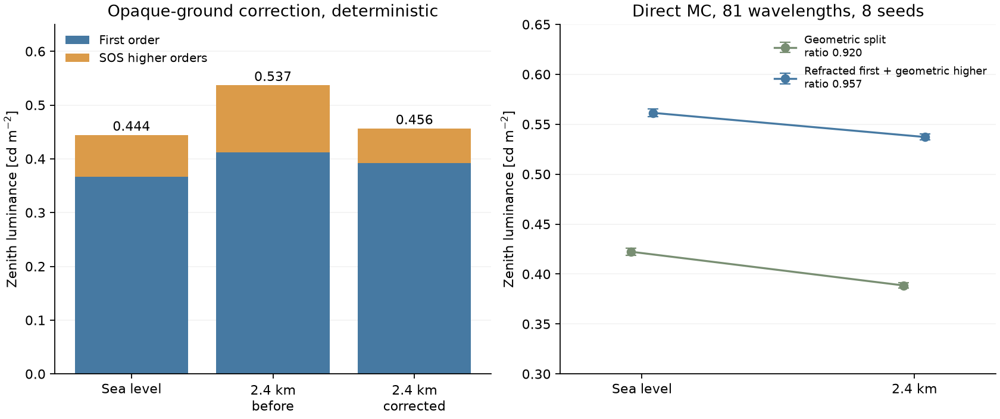

# 暮光海拔响应审计：遮挡缺陷、数值响应与观测边界

2026-10-31；起点 `a15555b`（M12 已合并），修复提交 `c45a03b`。
本报告取代临时 HANDOFF 对剩余问题的判断。
里程碑见 [ROADMAP](../ROADMAP.md)，当前状态见 [STATUS](../STATUS.md)；原始实验记录随代码提交在
[`validation/data/twilight_altitude_audit/`](../../validation/data/twilight_altitude_audit/README.md)。

## 结论

原来“高站更亮，所以低层多次散射必然不足”的结论应撤回。它混合了一个确切的几何缺陷、
不同后端的传输近似和未控制的站点差异。

1. **太阳遮挡确实有错，现已修正。** `at_altitude` 的积分域已经从高站开始，但太阳遮挡还按
   海平面判断，允许光线穿过高原球体。修正后，−6° 天顶的确定性高站/海平面亮度比
   **1.208 → 1.027**；海平面结果逐位不变，M10 的双分支弦长没有改动。
2. **球面高阶散射确实随此次截断减少。** 绕开引擎的角度平滑和光谱插值，以 81 波长、8 组
   独立种子的定向 MC 直接求高阶项，现有混合模型总亮度比为 **0.9568±0.0071**；纯几何
   split 模型为 **0.9201±0.0093**。高阶项自身的比值为 **0.7443**。这里 ± 是经验标准误，
   不覆盖物理近似、场景或测光误差。
3. **观测的 0.80 不是这次干预的硬目标。** 它是 Maryland photopic 与 Paranal Johnson-V
   之间的跨研究比值；站点、大气、年代和响应函数都不同。原始同仪器站点数据也没有控制空气
   透明度和季节，不能将其视为同一标准大气的纯海拔传递函数。

这次解决了可证明的遮挡错误，也建立了可重复的数值解释；并未证明模型已能预测真实站点之间
的全部差异，亦未证明某个特定物理成分缺失。

## 1. 实验究竟改变了什么

固定 `presets.clear`、AOD₅₅₀=0.05、臭氧 300 DU、地面反照率 0.1、太阳真实高度 −6°、
天顶视线和 380–780 nm / 5 nm 网格。对比海平面与 `at_altitude(2.4)`。

`at_altitude` 不改变各廓线的定义或柱量参数，而是移除 2.4 km 以下的计算域，并把不透明
球面地面及观察者一起抬高。它表示**全球球面地面抬高**。下面几件事都不与之等价：

- 气球升高，但地面和下方空气保留；
- 局地山峰升高，周围低地仍能参与照明与多次散射；
- 改变整条大气密度或地面气压；
- 换到另一个有不同气溶胶、温度、地形和季节的实际站点。

因此以这个实验解释机制是合法的，以跨站点的某个比值校准它则需要更多条件。

## 2. 遮挡缺陷的独立证据与修正

对于一个位置向量 `x` 和指向太阳的单位向量 `s`，在向前射线上直接求离地心最近的点：

```
t_min = max(-dot(x, s), 0)
x_min = x + t_min * s
blocked = norm(x_min) < r_ground
```

这个判据不调用求解器的太阳弦长实现。−6° 天顶方向的几何影高，在海平面约为 35.09 km，
在全球 2.4 km 地面约为 37.51 km。36 km 处的一条太阳线因此能越过海平面，却会进入高原
球体。旧 MC 在该点仍给出 550 nm 约 **0.00878** 的太阳透过率；正确结果是严格为零。
折射模型也必须用地面处的 Bouguer 阈值 `n_ground * r_ground`，而非观察者折射率乘海平面半径。

修正涉及 single、MC、SOS 的太阳遮挡，折射 grazing 阈值表，以及云层的直接照明和影高。
所有入口使用同一个 `r_bounds[0]`。**没有修改 `up + 2*down` 或任何 M10 弦长积分。**

新增 [14 项测试](../../tests/test_raised_ground.py) 用射线/球体相交、常折射率的解析切线、
阴影内薄散射层及气球/高原的差别独立裁定边界。原基线隔离导入时 **10 failed / 4 passed**；
修正后 **14 passed**。这条缺陷成立与否不依赖任何观测亮度目标。

## 3. 确定性分解：为什么原来会显著增亮

以下均为 cd m⁻²，默认每层 3 点 Gauss 积分：

| 分量 | 海平面（修复前后逐位一致） | 2.4 km 修复前 | 2.4 km 修复后 | 修复后高/低 |
|---|---:|---:|---:|---:|
| 一次散射 | 0.366115 | 0.411475 | 0.391830 | 1.0702 |
| SOS 高阶项 | 0.078164 | 0.125253 | 0.064520 | 0.8254 |
| 总量 | 0.444279 | 0.536728 | 0.456350 | **1.0272** |

旧的高阶项高度比是 **1.602**，修正后成为 **0.825**。遮挡阈值影响的是高空散射点能否看见
太阳，因此“只影响低层/地平线，不影响天顶暮光”的旧判断不成立。

修正后的微小净增亮由两个相反分量相加产生：一次散射增加约 0.0257，高阶散射减少约
0.0136。它是当前 SOS 近似的数值响应，不能单独归因为某种缺失物理。

一次散射的求积探针也已保留：Gauss 点数 3→24 时海平面为 0.366115→0.368403，
高站为 0.391830→0.393622。单点绝对值存在约 0.5–0.6% 的数值变化；对高度比的影响较小。
这里没有为了保住旧数字而改默认求积或重新生成 golden fixtures。

## 4. 绕开平滑和 anchor 的球面 MC

每个高度使用种子 100–107、每波长 100,000 条光子路径、81 个工作波长、天顶一个方向。
总共 129.6 million wavelength-paths。所有波长直接计算，没有角度平滑、光谱 anchor 插值
或对噪声取对数。按 CIE photopic 响应直接积分每次光谱，再对独立种子求均值。

| 分量/模型 | 海平面均值 | 2.4 km 均值 | 高/低比 ± 经验标准误 |
|---|---:|---:|---:|
| 几何 MC 高阶项（含地面） | 0.195318 | 0.145372 | 0.7443 ± 0.0178 |
| 纯几何 MC 总量 | 0.424918 | 0.390969 | 0.9201 ± 0.0093 |
| 几何确定性一次 + MC 高阶 | 0.422342 | 0.388582 | 0.9201 ± 0.0093 |
| 折射太阳弦一次 + 几何 MC 高阶 | 0.561433 | 0.537202 | **0.9568 ± 0.0071** |

几何 MC 总量与几何 split 结果在本次种子散布内一致，为分解提供了一条独立的运输取证链。
但它们仍共享大气定义、物种与部分几何，不能据此排除共同错误；遮挡错误另由解析几何取证。

这些结果给出了自洽的分量解释：截断后，一次项净增加，与视线低层消光减少的方向一致；
高阶项净减少，与移除下部参与区域的方向一致。球面 MC 的高阶减量约 0.0499，超过一次散射
增量约 0.0257，所以净变暗约 4.3%；
SOS 的高阶减量较小，净结果仍增亮约 2.7%。光路/源项的额外变化也包含在该干预中，不能把
两个分量的差分直接解释为某一高度层孤立发出的光。

均值之比采用配对 delta method：令 `R=mean(high)/mean(low)`，对各种子计算
`(high_i - R*low_i)/mean(low)`，其样本标准差除以 `sqrt(n)` 为标准误。同名种子不保证
跨高度保持相同路径；计算使用实际种子间协方差，不假定 common-path 降方差。
原始种子值和经验 t 区间在 `summary.json`。8 个种子仍不能证明极稀有尾事件已经收敛。

另外以生产引擎 `quality="low"`、种子 0–3 复查：海平面均值 0.558437、高站 0.533317，
比值 **0.9550±0.0177**，与不经插值的直接结果一致。每个高度/种子使用 5 个 anchor、
每 anchor 4 million 路径、6×8 个方向；4 组的经验 t 区间约 0.899–1.011，单独还不能
裁定小幅变暗。此复查没有证明深暮光的插值偏差小，也没有沿用单次引擎误差条作真值。



## 5. 仍然存在的传输近似

- **single**：太阳衰减和遮挡使用折射太阳弦；观察视线与相函数散射角仍按几何方向计算。
- **SOS**：平面平行漫射场；折射开启时使用折射阴影阈值，但太阳束光学深度仍走几何弦长。
- **MC**：球面几何运输与太阳 next-event 都不折射。
- **twilight 引擎**：折射太阳弦的一次项 + 几何 MC 高阶项；它不是完整折射辐射传输。

所以 0.957 与 0.920 的差不能解释为完整折射效应。海平面亮度没有因为修复遮挡而改变，
也不能证明这些近似无关紧要。深暮光噪声 anchor 经 log 插值还可能有统计负偏：
`E[log X] != log E[X]`。本轮没有测量其在 −9°/−12° 的大小，不能用它解释全部偏差。

## 6. 原始观测究竟约束什么

[Patat et al. (2006), §4–5](https://arxiv.org/html/astro-ph/0604128) 的 CrAO/Paranal 比较
给出太阳俯角 5.5–11° 的平均差 0.27±0.03 mag（约 0.780±0.022 的通量比）。CrAO
来自 2002 年 12 月三个晨暮光，Paranal 是不同仪器和样本。论文并没有隔离分子密度、
低层气溶胶和二者组合的贡献。961/743 hPa 的压力比相近是候选解释，不是受控因果证据。

[Koomen et al. (1952) 原文 pp.353–354](https://static1.squarespace.com/static/54694fa6e4b0eaec4530f99d/t/5e876886cdfbaa441f538327/1585932427823/Measurements%2Bof%2Bthe%2BBrightness%2Bof%2Bthe%2BTwilight%2BSky%2B1952.pdf)
Tables I/II 的天顶列给出：−6° 高站 0.022、低站 0.060 cd ft⁻²，比值 **0.367**。
原文图像已逐格目视核对；转录值、坐标和条件在数据目录。高站是 1951 年 5–6 月，低站
是 1–3 月；报告的垂直太阳透过率分别为 85–90% 与 75–85%。仪器含绿色滤光片，并非旧文档
所说的“无滤光片”。表格来自平滑观测曲线，没有逐格误差条；本轮不人为补造误差。

同仪器零点会在比值中消去，但频带转换不必消去。若 `C[S]=photopic[S]/V[S]`，则
`P_high/P_low = (V_high/V_low) * (C_high/C_low)`。只有光谱形状相同或合成测光证明 C 相同，
两种比值才一致。本轮没有真实 V 响应函数的合成测光，因此不宣称其误差必为 10–20%。

这些观测支持真实站点间存在很大的暮光差异；本轮不能给这些差异指定唯一成因。新增原文
转录独立存放，没有改动已有 Koomen/Patat 校验基准。

## 7. 验证、复跑与下一步

现有全量测试 **257 passed / 361.33 s**；新增地面遮挡测试另跑 **14 passed / 1.85 s**
（全量进程收集测试时，新测试文件尚未加入）。六项物理校验仍为 **3 PASS / 3 FAIL**，
`validation/results.json` 与提交基线无差异；既有失败不是本次回归，也没有被“修绿”。

```bash
# 在目标 checkout 中重建其自己的环境，检查实际导入路径
uv sync --frozen
uv run python -c 'import skycolor; print(skycolor.__file__)'

uv run pytest -q
uv run python -m validation.run_all

# 当前确定性与不经插值的直接 MC；结果逐次追加，因此使用新输出文件
uv run python -m tools.twilight_altitude_audit deterministic --out out/alt-det.jsonl
uv run python -m tools.twilight_altitude_audit direct --out out/alt-direct.jsonl \
    --seeds 100 101 102 103 104 105 106 107 --photons 100000 \
    --wavelengths $(seq 380 5 780)
uv run python -m tools.twilight_altitude_audit engine --out out/alt-engine.jsonl \
    --quality low --seeds 0 1 2 3

# 读取提交的原始记录，重算统计量并重画图；不运行辐射传输
uv run python -m tools.summarize_twilight_altitude
```

后续最有信息价值的两条路线可以分别推进：

1. **传输误差**：先在 MC 中隔离折射太阳照明与漫射路径弯曲的影响，保留几何参考和独立
   路径验证；对更深暮光先检验多种子统计和谱插值偏差，再决定是否重做估计器或球面 SOS。
2. **站点预测**：选择一个有气压、透明度/AOD、臭氧和通带信息的站点，明确全球高原与局地
   地形的差别，再做同频带比较。其验收对象应是条件明确的观测，不是通用的 0.80。

当前没有证据支持为了拟合站点比值而任意调整密度、关闭折射或重做 M10 弦长修复。

## 后续阶段

2026-11-01 已完成后续太阳源消融、统一源、AOD550 修复、连续漫射传播与观测边界审计。
顺序与报告分工见[文档目录](README.md#audit-sequence-m13m18)，最终结论见
[CURVED_TRANSPORT_AUDIT.md](CURVED_TRANSPORT_AUDIT.md)。本报告数值仍表示 M13 处方；
后续实验未追溯改写它们，统一源与曲线传播也尚未替换生产默认。本文旧引擎 anchor
结果早于 AOD550 修复；完整 81 波长的直接 MC 光学不受该修复影响。
