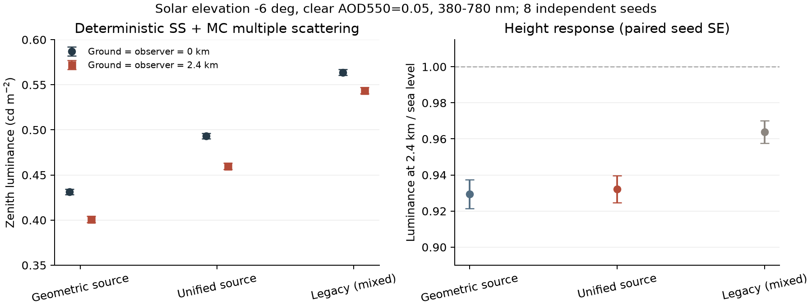

# 统一太阳源：连续柱量、二维日面与 SS/MC 闭合

2026-11-01；第三阶段，承接[太阳源审计](SOLAR_SOURCE_AUDIT.md)。
基线 `596aaba`，实验实现的具体版本另由原始记录中的 `source_hashes` 固定。

> 阶段定位：报告末尾提出的 straight/连续曲线比较已在
> [CURVED_TRANSPORT_AUDIT.md](CURVED_TRANSPORT_AUDIT.md)中完成本轮有界实验。
> 本文只承载源项与直线漫射证据；生产单源化、稳定统计和匹配观测仍是后续候选。

**本阶段建立了一个能通过独立方向、柱量、能流和一次项统计检验的实验太阳源。**
在太阳真实高度 −6°、clear、天顶这一受控场景中，统一源的
“确定性一次项 + MC 高阶项”给出海平面 **0.493233±0.003081 cd m⁻²**、
2.4 km **0.459769±0.003474 cd m⁻²**，高/海比为 **0.932154±0.007479**。
两种高度的确定性 SS 与 MC 一次项分别只差 0.12、0.23 个种子标准误。

这里的 MC 漫射自由程仍沿直线，明确保留为源项消融。本报告不签发完整折射天空的结果，
不使用阶段四的曲线 MC 数值，也不把这个高度比解释成真实站点的预测。

## 1. 从分散处方到同一个局地太阳源

第二阶段发现，方向逆插值、太阳柱量、光束定幅和有限日面都能影响绝对亮度。
本阶段把它们组合成一个独立实验源，再同时供给确定性一次积分和 MC 的 solar NEE。

- `RadialSolarMapping` 在同一个连续折射率廓线中，以 Bouguer invariant
  `a=n(r)r cos(e_app)` 反求真实/视高度映射；只接受单调 `n(r)r` 的单像介质。
- `ContinuousSolarColumns` 独立积分连续 air/O3/NO2/aerosol 密度，不沿用生产 shell
  弦长近似。积分核为 `ds/dr = n*r/sqrt((n*r)²-a²)`，`r=r_start+u²` 去掉切点奇性。
  向下路径分为 turning→top 与 turning→point；碰地为遮挡，model top 之外无消光。
- `PointSolarTable` 在 ground-grazing 对齐的坐标内存储方向及 species columns，
  对高度使用 `sqrt(height-ground)` 插值。增益从**同一个方向插值式的导数**计算，
  不单独插值另一份 G。NPZ 只按显式 label 与同一实验 medium 契约加载，不是通用缓存。
- `FiniteSolarSource` 对真立体角积分均匀二维太阳盘，半径 16′；每个盘面方向分别求
  apparent direction、连续消光和局地角域增益，再用于 scattering phase 与 ground incidence。
  采用中心法向平面的远场太阳光谱辐照度归一，包含日面方向的法向余弦检查。

局地太阳源增益与检测器参考转换为：

```
G_local = (n_vertex/n_inf)^2 * dOmega_app/dOmega_true
G_detector = G_local * (n_observer/n_vertex)^2
           = (n_observer/n_inf)^2 * dOmega_app/dOmega_true
```

沿无损折射路径守恒的是 `L/n²`。散射和 Lambertian 地面反射都发生在同一个局地 n，
不再重复乘 n²；MC propagation 保留 reduced-radiance 权重。这解释了 source、地面
和后续曲线 flight 可以如何组合，但尚不是本阶段已验证了曲线 MC 的声明。

## 2. 独立数值链与精度范围

**能流链。** `check_solar_etendue.py` 用 Cartesian DOP853 追踪平行 ray tube，
直接以远近截面积之比求光束能流变化，检验值不使用角导数或 n² 公式。
标准四点含 38/40/47 km、真实太阳 −6° 和低空日间点，束宽 5/20/80 m 的最坏相对差
为 3.12×10⁻⁵；38 km 的 G≈0.616741。常 n=1 及 1.000278 均恢复 G=1。
二维日面的法向辐照度归一回到 1，误差为浮点舍入量级。

**高层反例与修正。** 100 km、apparent≈−9.485385° 的路径 turning 接近廓线 knot。
最初未按 spline knots 分段的径向曲率积分，角度误差很小，微分后却产生不稳定导数：
8/16/32 点 Gauss 给出 1.30559/1.36600/1.33152。按 knots 分段后，
1e−5° 尺度导数收敛到约 1.337712，独立 DOP853 支持同一解。
进一步缩小导数/束宽后，点源 G≈0.748400，与 0.5–2 m ray tube 一致。
这也保留了一个边界：有限差分宽度与有限束宽会平滑 knot 附近的真实局部变化，不能把
一个宽度上的一致性视为任意点导数的证明。

**连续柱量链。** 海平面及 ground=2.4 km，各在 30/38/40/47 km、太阳 −6° 的正确
根角测试，共八个点；径向 Gauss 与独立 Cartesian RK 同时积分连续密度的结果相比，
8 点 Gauss 的 T550 最大相对差 1.16×10⁻⁶。8→16 点的 T550 变化小于 7.3×10⁻⁸。
常 n 的直线解析 air column 相对差小于 9×10⁻¹³；零 species、穿地和顶部出射限制均检查。
1000 ray、8 点积分的本机 warm 时间约 0.57–0.64 s，仅作为算法量级记录。

**点源表 heldout。** 使用海平面 157 行/13832 knots、高站 151 行/12852 knots 的
81 波长折射表；保存后重载查询逐位一致。holdout 与建表 refinement 点不同，但共享
同一径向 oracle，所以独立物理证据仍来自上面的 RK/ray-tube 链。

| 折射表误差 | 海平面 | ground=2.4 km |
|---|---:|---:|
| apparent angle 最大绝对差 [deg] | 9.66e−5 | 1.40e−4 |
| G 最大相对差 | 0.400% | 0.470% |
| 有效 T×G 最大相对差 | 0.405% | 0.424% |
| 全域 T 最大绝对差 | 0.001538 | 0.001217 |
| shadow 状态分歧数 | 0 | 0 |

“有效 T×G”仅计参考源幅度 ≥1e−4 的采样点。极暗点的相对误差不被这列代表；
全域绝对误差另列。上述都是本次 holdout 的观测最大值，不是任意自定义大气的误差保证。
几何表也归档，其高站有效 T 相对误差最大约 0.731%，绝对误差约 0.001211。

**SS 和日面收敛。** 海平面从 2×8 到 4×16 日面方向，确定性一次亮度
0.276931685→0.276924020；再把 view Gauss 8→12、segment 0.5→0.25 km，
变为 0.276923436，联合变化约 0.003%。点日面则为 0.271479431，说明有限日面在这里
约有 2% 的效应。此收敛只检查该场景的 SS；不冒充所有 MC source vertices 的日面误差上界。

## 3. 48 条全光谱记录：source-only 配对实验

固定 clear/AOD550=0.05、300 DU、默认地面反照率 0.1、太阳真实高度 −6°、天顶，
380–780 nm/5 nm，共 81 波长。ground=observer=0 或 2.4 km；高站是相同大气的一致
截断，不重标定柱量。每个模式、每个高度运行种子 200–207，各波长每 seed 100,000 路径，
总计 388.8 million wavelength-paths。三种 source 的每组(height, seed) NEE 点序列
SHA256、调用次数和点数完全相同，共 16 组配对；不同 seed 的指纹均不同。

三种模式的界限是：

- **Geometric**：几何太阳方向/连续直线柱量/完整日面，SS 和 MC 共用此源。
- **Unified**：连续折射方向/连续曲线太阳柱量/角域定幅/完整日面，SS 和 MC 共用此源。
- **Legacy**：库的现有折射确定性 SS，加原几何 MC 高阶项。它是旧混合组合的参照，
  SS 与 MC 没有同一个太阳源，不能作为闭合的物理解。

| 模式，亮度 [cd m⁻²] | SS 海平面 | MC 高阶海平面 | SS 高站 | MC 高阶高站 |
|---|---:|---:|---:|---:|
| Geometric | 0.232201 | 0.199335±0.003032 | 0.248287 | 0.152785±0.003469 |
| Unified | 0.276932 | 0.216302±0.003081 | 0.295624 | 0.164146±0.003474 |
| Legacy，源混用 | 0.366115 | 0.197724±0.003022 | 0.391830 | 0.151662±0.003464 |

| 模式 | SS+MS 海平面 [cd m⁻²] | SS+MS 高站 [cd m⁻²] | 高/海 |
|---|---:|---:|---:|
| Geometric | 0.431535±0.003032 | 0.401072±0.003469 | 0.929406±0.008024 |
| Unified | 0.493233±0.003081 | 0.459769±0.003474 | 0.932154±0.007479 |
| Legacy，源混用 | 0.563840±0.003022 | 0.543492±0.003464 | 0.963913±0.006184 |

全部 ± 是 **8 组独立种子之间的一个经验标准误**。先逐 seed 积分完整光谱为 photopic
亮度，再统计，因此没有假定波长之间独立。高度比是两个 seed 均值之比，其 SE 由同 seed
高低站的协方差做 delta propagation，既不是逐 seed ratio 的均值，也没有假定高低站
有相同路径。相同路径只在同高度的 source 变体之间成立。

Unified 的总量相对旧混合组合下降约 12.5%/15.4%，相对完整几何源增加约 14.3%/14.6%。
这些点估计同时包含太阳源及确定性一次积分处方变化，不能将全部差额归给单独一个 G 因子。
高度比仍在 0.93 附近，绝对源修正不会自动解决真实跨站点大气、地形和观测差异。



## 4. 一次项闭合的证据与限制

| 同一太阳源 | 确定性 SS | MC 一次项均值±seed SE | 差额/seed SE |
|---|---:|---:|---:|
| Geometric 海平面 | 0.232201 | 0.232460±0.001950 | +0.133 |
| Geometric 高站 | 0.248287 | 0.248750±0.002249 | +0.206 |
| Unified 海平面 | 0.276932 | 0.277170±0.002012 | +0.118 |
| Unified 高站 | 0.295624 | 0.296122±0.002210 | +0.225 |

这是 photopic 一次项的统计相容性，不是每波长已精确收敛的证明。81 波长逐点诊断中，
Unified 最大绝对标准化差额为海平面 4.07、高站 3.93，均在 505 nm；分别有 2/3 个波长
超过 3 个 seed SE。8 个重复的局地 SE 本身有不确定度，且进行了多重逐点比较；共享路径的
Geometric 也在同一波长出现约 −3.7 的差额。完整逐点诊断保留在 summary.json，
现有预算支持 photopic 闭合，不能据此签发逐点高精度一致性。

Legacy 的 MC 一次项仅约 0.228134/0.244126，与它的折射确定性 SS 相差约
−71.2/−65.7 个 seed SE。这个大差额来自不同的太阳源定义，本阶段不以它检验统一源。

确定性 SS 读连续密度，MC 在 fine-grid 上 log 插值，二者还有各自的数值离散误差；
NPZ holdout、SS/view/disk 积分误差与直线漫射近似均不包含在统计误差条中。

## 5. 归档、复跑与后续边界

永久原始光谱、源表、输入 SHA256、独立探针和统计在
[`validation/data/unified_solar_source_audit/`](../../validation/data/unified_solar_source_audit/README.md)。
它们不依赖 scratchpad 或本机绝对路径。重新核对输入并生成汇总/科研图：

```bash
uv run python -m tools.summarize_unified_source
```

按归档的四份源表重跑 MC（JSONL 为追加写入，请使用新输出文件；完整运行需较长时间）：

```bash
uv run python -m tools.run_unified_solar_audit \
  --tables-manifest validation/data/unified_solar_source_audit/tables-manifest.json \
  --table-dir out/unified-source-tables --out out/unified-source-new.jsonl \
  --modes geometric unified legacy --elevations 0 2.4 --seeds {200..207} \
  --wavelengths {380..780..5} --photons 100000 --sun -6 --transport native
```

这些阶段三原始记录在 aerosol 550 nm normalization 修复之前产生；所有实验均使用包含
550 nm 的完整 81 波长网格，该修复对本批光学量逐位不变。不能把本结论外推给不含
550 nm 的旧 anchor 网格；该缺陷独立记录在 [AEROSOL_GRID_AUDIT.md](AEROSOL_GRID_AUDIT.md)。
阶段三当时的全量测试为 **298 passed / 324.05 s**，日志随数据归档；汇总脚本另独立核对
所有输入 SHA256、NPZ label/medium 契约、48 条光谱积分、种子覆盖及 source 配对指纹。

生产太阳表、M10 弦长和物理回归数字没有在这一源项实验中被替换。下一步应独立比较
straight 与连续曲线漫射，分别审 RK 步长、地面/TOA 事件和 MC 统计收敛；阶段四将另记，
不能将尚未验证的曲率项并入本报告。
